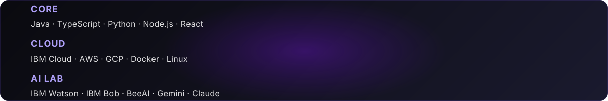
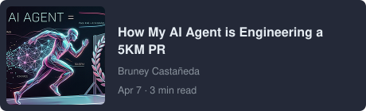
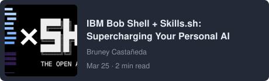
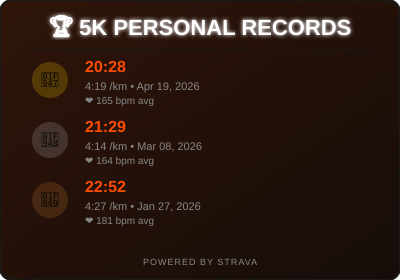
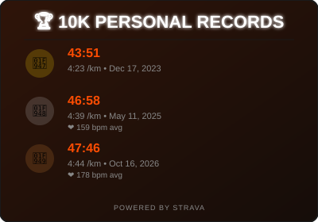
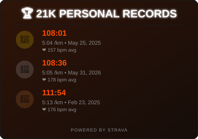
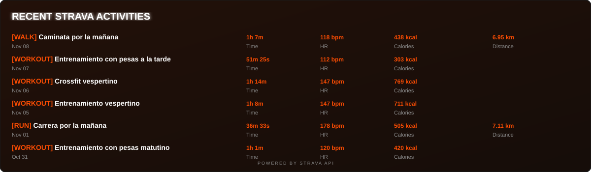

***

> ⚠️ **AI-Generated Disclaimer:** All information in this README was researched and written by an AI agent. It is automatically updated every day to keep data current. Content may not reflect real-time changes made outside of scheduled update cycles.

***

***

### Professional Journey

**Edgar Bruney Castañeda** is an experienced engineer at **IBM's CIO Organization** in **Zapopan, Jalisco, Mexico**, specializing in translating research-grade AI into production systems. A GitHub member since **2013** with over 13 years of experience in the tech industry, he has built a distinguished career focused on cutting-edge technology implementation and open-source contribution.

Currently working at the intersection of **agentic AI development** and **cloud architecture**, Edgar designs and implements multi-agent pipelines using frameworks like **BeeAI**, **CrewAI**, and **LangGraph**. His work spans from concept to deployed REST APIs with async jobs and live SSE streaming, with emphasis on practical applications that solve real-world problems. He specializes in verify-and-retry orchestration loops and production-ready AI systems that bridge the gap between research and enterprise deployment, demonstrating a unique ability to transform research-grade AI into practical enterprise solutions.

His open-source work centers heavily on quantum computing and autonomous agent systems. He created the **Quantum Lab Agent System**: a five-agent A2A network — Developer, Status, Computing, and Experiment specialists — all orchestrated by a central Lab Agent and powered by **IBM Granite 4.2 8B** running locally via Ollama. The system features an Agent Stack Canvas integration for circuit visualization, live backend topology dashboards, and end-to-end QAOA Max-Cut experiments on real IBM Quantum hardware including `ibm_marrakesh`. In October 2026, he published **[quantum-and-cybersecurity](https://github.com/BrUn3y/quantum-and-cybersecurity)**, an interactive presentation and hands-on workshop hosted on [GitHub Pages](https://brun3y.github.io/quantum-and-cybersecurity/) exploring quantum computing foundations, post-quantum cryptography (PQC) standards, cryptographic migration strategies, and real-QPU Bell state generation with Qiskit. Through mid-October 2026 he continually enhanced the workshop — simplifying core explanations of quantum superposition and entanglement, clarifying cryptographic acronyms and mathematical foundations (symmetric vs. asymmetric encryption, NIST PQC standards), integrating a NotebookLM study guide and slide timing labels, adding PQC library references, simplifying the Shor's algorithm explanation, and streamlining the quantum-risk guidance slide — with the final polish landed on **October 15, 2026**.

Edgar is also a core organizer of **Quantum Guild GDL** (established August 17, 2026), a Guadalajara-based community co-organizing the **[Qiskit Fall Fest Guadalajara 2026](https://quantum-guild-gdl.github.io/qiskit_fall_fest_gdl/)** — a free, two-day community quantum computing festival held **October 28–29, 2026** (CST) with both days streamed **online** — the event has now **concluded**. All event content will be delivered in **Spanish** to support the regional Spanish-speaking quantum developer community. The festival features a two-track parallel schedule — a *Round Table for Decision Makers (Presencial Only)* running alongside main quantum computing sessions — Discord integration, and Luma ticketing. The site updates on **October 26, 2026** fixed swapped organizer photos, sorted all organizers alphabetically, and added five new organizers, bringing the full organizing team to ten members. On **October 26, 2026**, the session title for the 09:20–10:20 CST slot was updated to **"Cuántica + IA"**, highlighting the fusion of quantum computing and artificial intelligence as one of the core themes of the event. On **October 25, 2026**, an **Access & Check-in** item was added at 08:45–09:00 CST (in-person only) and the Round Table session received an **"Only Decision Makers"** label. Prior updates through October 23 added an **access video modal** to the venue section, aligned the venue buttons on a single row, removed a broken icon from the IBM SkillsBuild QR slide link, and introduced **registration deadlines** under each ticket tier (client-side auto-close logic). On **October 29, 2026**, the site moved into post-event mode: the Discord and "Get your ticket" buttons were removed, the hero text was rewritten in the past tense, and the Register section was replaced by a new **Gallery** section added to the navbar. On **November 3, 2026**, Edgar opened and merged four follow-up pull requests: the Gallery became an interactive showcase of 40 curated event photos (three slow-moving rows, hover-to-pause, full-screen viewer with keyboard navigation; PR #30), was expanded to **60 photos** with optimized WebP previews (PR #31), and the two **Day 1 recordings** (Part 1 and Part 2) were embedded beside the Schedule timeline with click-to-load YouTube players (PR #32), with Part 1 set to start at 1:00:00 to skip the empty opening hour (PR #33). Earlier, on **October 27, 2026**, both Tier 1 and Tier 2 registrations were closed — the Luma links were removed and replaced with disabled **"Registro cerrado"** buttons, and the deadline text and auto-close scripts were dropped since registration is now permanently closed. On **October 21, 2026**, an **IBM SkillsBuild QR slide** (scene 7) was added, inviting attendees to join the free Quantum Computing Learning Plan (2 digital credentials, plan `PLAN-3793AAC77C46`). Headliner speakers were announced.

Edgar's open-source contributions span major generative programming, agent orchestration, quantum ecosystems, and NASA open science. Across **Qiskit**, his **[PR #3426](https://github.com/Qiskit/qiskit-ibm-runtime/pull/3426)** (*"Expose timestamps in Session/Batch details()"*) to **[Qiskit/qiskit-ibm-runtime](https://github.com/Qiskit/qiskit-ibm-runtime)** was **merged on October 7, 2026**, exposing session transition timestamps in `Session.details()` and `Batch.details()`, while **[PR #3425](https://github.com/Qiskit/qiskit-ibm-runtime/pull/3425)** hardens `rzz` gate angle validation against `nan` values. For **IBM Hacktoberfest**, both of his UI bug-fix contributions to **[dam-agents/dam](https://github.com/dam-agents/dam)** were accepted and **merged**: **[PR #4287](https://github.com/dam-agents/dam/pull/4287)** (*merged October 3, 2026*) preventing React portal event bubbling during session deletions, and **[PR #4285](https://github.com/dam-agents/dam/pull/4285)** (*merged October 7, 2026*) retaining dialog content through the close animation. In the Microsoft quantum ecosystem, he submitted **[PR #3899](https://github.com/microsoft/qdk/pull/3899)** to **[microsoft/qdk](https://github.com/microsoft/qdk)** (open, Microsoft CLA signed October 12, 2026), adding Q# language-service completion test coverage for notebook package dependencies (closing issue #1768). On **November 5, 2026** he published **[Qiskit Lab](https://github.com/BrUn3y/qiskit_lab)** — a Qiskit SDK workspace packaged as a **DAM starter kit** for circuit development, local simulation, QAOA Max-Cut experiments, and explicitly requested IBM Quantum hardware jobs via Qiskit Runtime `SamplerV2` — shipping releases **v0.3.0** and **v0.3.1** the same day, and opened **[dam-starter-kits PR #18](https://github.com/dam-agents/dam-starter-kits/pull/18)** to list it in the official DAM catalog (open). On **November 9, 2026**, Qiskit Lab advanced through **v0.3.2**, **v0.3.3**, and **v0.3.4** (reproducible setup and quality gates), and the same day he also published **[qiskit-advocate-program](https://github.com/BrUn3y/qiskit-advocate-program)**, an 18-slide Spanish presentation on the Qiskit Advocate Program. On **November 10, 2026**, he merged three more Qiskit Lab pull requests: a fix for CHSH report metadata and independent simulation sampling (PR #8, adding native CHSH support and an offline `qiskit-lab report --input` command), a README wording cleanup (PR #9), and **PR #10**, which bundles all four official **[Qiskit AI Skills](https://github.com/Qiskit/skills)** (Runtime migration, error mitigation, SQD eigensolver selection, and fermionic simulation) with agent task routing, and he starred the `Qiskit/skills` repository the same day. On **November 11, 2026**, he shipped **[Qiskit Lab v0.4.0](https://github.com/BrUn3y/qiskit_lab/releases/tag/v0.4.0)** (*"CHSH experiments and durable results"*) after merging PRs #11–#20 in a single day: a native local `qiskit-lab chsh` workflow with finite-sample 95% Hoeffding confidence bounds, results persisted before dashboard rendering, durable recovery of ambiguous IBM submissions (`recover-submission`), versioned receipts with actionable error diagnostics, isolated optional SQD/fermionic environments, and skill evaluations with a review-only update workflow — validated with 709 offline tests at 98% coverage on Python 3.11–3.13. On **November 6, 2026**, he published **[ai-journey](https://github.com/BrUn3y/ai-journey)** (live at [brun3y.github.io/ai-journey](https://brun3y.github.io/ai-journey/)), an interactive 15-slide Spanish presentation with IBM Carbon styling covering AI agent evolution for IT support, DAM integration, and early architecture steps toward an AI Software Factory leveraging Claude Code, Codex, and Bob in the cloud on IBM Research infrastructure. In early November 2026 he kept two open pull requests moving: on **November 3, 2026** he merged the latest upstream `main` into his **[Omnigent PR #8902](https://github.com/omnigent-ai/omnigent/pull/8902)** branch, resolving conflicts so the Bob harness reuses the shared runner launch lock registry, and asked the maintainers to review **[earthdata-search PR #2099](https://github.com/nasa/earthdata-search/pull/2099)** after the AccessMethod and SwodlrForm test suites passed locally (73 tests). On **November 2, 2026** he also published **[ica-learning](https://github.com/BrUn3y/ica-learning)**, a 12-slide Spanish presentation on IBM Consulting Advantage (ICA) for accounting and administration, and shared a working example in **[dam-agents/dam issue #6134](https://github.com/dam-agents/dam/issues/6134)** of running Claude Code on DAM against ICA's Anthropic-compatible Messages API. On **November 3, 2026**, he also pushed a Google Drive webhook and Gemini Live ingestion pipeline to the Bob harness (`feat/google-drive-gemini-live`), the backbone of his new **Gemini Live to Pages** voice-to-website experiment.

Additional upstream contributions include **[PR #1676](https://github.com/generative-computing/mellea/pull/1676)** to **[generative-computing/mellea](https://github.com/generative-computing/mellea)** (**merged September 28, 2026** for dynamic OpenAI adapter deregistration) and **[PR #3930](https://github.com/heygen-com/hyperframes/pull/3930)** to **[heygen-com/hyperframes](https://github.com/heygen-com/hyperframes)** (**merged September 22, 2026** adding IBM Bob Shell runtime support). Edgar also published **[TriForge](https://github.com/BrUn3y/triforge)** on **September 23, 2026** — orchestrating Codex, Claude Code, and IBM Bob Shell into an auditable multi-agent engineering council. On **September 24, 2026**, Edgar forked **[strands-agents/harness-sdk](https://github.com/strands-agents/harness-sdk)** (9,075⭐, 1,480 forks) — the open-source Python & TypeScript SDK for building production AI agent harnesses across any model and cloud — signalling interest in contributing to the Strands Agents ecosystem. On **October 12, 2026**, Edgar forked **[NASA Earthdata Search](https://github.com/nasa/earthdata-search)** (829⭐, 262 forks) — NASA EOSDIS's web application for Earth science data discovery — and opened **[PR #2099](https://github.com/nasa/earthdata-search/pull/2099)** (*"Fixes typos in SWODLR access method and tooltip text"*), correcting user-facing spelling errors in the SWODLR access method and constants, linked to issue #2098. On **October 16, 2026**, he forked **[rea](https://github.com/BrUn3y/rea)** — an agent-driven reverse-engineering project for working from app behavior down to native binaries — expanding his exploration of agentic AI tooling. On **October 23, 2026**, Edgar published **[skills-ai-week](https://github.com/BrUn3y/skills-ai-week)** — a comprehensive visual guide (in Spanish) explaining how AI agent skills work across Claude Code, Codex, and IBM Bob, created with Archify. The guide features four interactive Mermaid diagrams covering the skill activation lifecycle, file structure, framework comparisons, and an agent decision tree. On **October 25, 2026**, Edgar forked **[nxnative](https://github.com/BrUn3y/nxnative)** (13,377⭐, 2,314 forks) — a cutting-edge project that converts Nintendo Switch game packages (NSP files) into unsigned IPAs capable of running natively on iPhone, iPad, and Mac via an NSO rewriter, Horizon HLE host, and NVN-to-Metal translation layer — expanding his portfolio into systems-level mobile and gaming engineering. On **October 26, 2026**, Edgar launched **[BrUn3y.github.io](https://github.com/BrUn3y/BrUn3y.github.io)** — his new personal website (live at [brun3y.github.io](https://brun3y.github.io/)) built with Y2K aesthetics, featuring AI agents, quantum computing content, and a custom **BRUN3YAMP** music player. The site integrates live Spotify data and is actively maintained with daily automated updates. By **October 27, 2026**, he had replaced the original Spotify widget with an in-house **Cyber Music Lover Radio** player featuring animated playback bars and live song display, and on October 27, 2026 added a rotating retro globe with decorative signals, an IRC-style retro chat (`brun3y` channel) with radio chatter and an unread-message indicator, classic web buttons under the Open Source sidebar, and retro forum share-image metadata.

### Technical Expertise

Edgar holds multiple industry certifications:

* **IBM Generative & Agentic AI Expert Developer**
* **AWS Serverless Badge Holder**
* **Hybrid Cloud Microservices Architect**

His comprehensive technical stack includes:

* **AI/ML Frameworks:** BeeAI, CrewAI, LangGraph, Mellea (generative programming), AgentStack SDK, Harness SDK, Strands Agents SDK, A2A protocol, IBM Granite 4.2 8B (Ollama)
* **Cloud Platforms:** IBM Cloud, AWS, multi-cloud architecture design and implementation
* **Quantum Computing:** Qiskit, QASM 2.0/3.0, QAOA, VQE, Grover, Shor, Deutsch-Jozsa, QFT algorithms; Post-Quantum Cryptography (PQC) standards and migration; real-hardware execution on IBM Quantum; upstream contributor to Qiskit/qiskit-ibm-runtime (PR #3426 merged, PR #3425) and qiskit-addon-sqd (Sample-based Quantum Diagonalization); Agent Stack Canvas for circuit and topology visualization; hybrid quantum-classical multi-agent systems; Microsoft QDK (Q#, resource estimator, Quantum Katas) — upstream contributor via PR #3899 (notebook dependency completion coverage, Q# language service, open)
* **Integration Technologies:** REST API design, Docker containerization, Slack integration (Socket Mode), Strava API, Google Fit API, Huawei Health API, CLI-Hub public catalog (CLI-Anything, 58,414⭐)
* **Specializations:** Multi-agent pipeline design with A2A protocol, verify-and-retry orchestration loops, async jobs with live SSE streaming, enterprise AI deployment, generative programming and backend adapter management (Mellea), HTML-to-video rendering for agents (hyperframes / HeyGen), Kubernetes agent sandboxing (DAM platform — PRs #4285 and #4287 merged), multi-agent peer-review orchestration (TriForge), interactive architecture diagram generation (Archify), React/TypeScript UI engineering (dam-agents/dam), native TUI harness integration (Omnigent meta-harness, 11,274⭐), CLI catalog registration (HKUDS/CLI-Anything, 58,414⭐), production agent harness engineering (strands-agents/harness-sdk), NASA Earth science data platform contributions (earthdata-search, 829⭐), systems-level mobile/gaming engineering (nxnative fork — Switch-to-iOS NVN to Metal), IBM Consulting Advantage (ICA) agent enablement and Anthropic-compatible endpoint integration (ica-learning, DAM issue #6134), voice-driven automation with Google Drive webhooks and Gemini Live (Gemini Live to Pages), personal website development and creative front-end (BrUn3y.github.io, Y2K aesthetics), event-site engineering (Qiskit Fall Fest GDL gallery and video recordings), DAM starter-kit packaging and catalog publishing (Qiskit Lab v0.4.0 with native CHSH experiments, durable result recovery, and bundled official Qiskit Agent Skills, dam-starter-kits PR #18), IBM Carbon-inspired interactive presentation design & AI Software Factory architecture (ai-journey)

### Featured Projects

**[AI Journey — Presentation & AI Software Factory Overview](https://github.com/BrUn3y/ai-journey)** — Published on **November 6, 2026** and live at [brun3y.github.io/ai-journey](https://brun3y.github.io/ai-journey/), this is a 15-slide Spanish-language interactive presentation with an IBM Carbon-inspired design (IBM Plex Sans/Mono, grid, Carbon grays and blue 60). It covers the evolution of AI agents for IT support and development across 2025–2026 (slides 1–11) — including the **Ask e-Config** orchestrator, with a results summary showing a 60% improvement and approximately 200 fewer support tickets, and SOVA development tasks managed through Slack with cloud agents — then DAM integration and early steps toward an AI Software Factory leveraging Claude Code, Codex, and Bob in the cloud on IBM Research infrastructure (slides 12–14), and concludes with Q\&A, an offline standalone HTML download, and mobile gesture support.

**[BrUn3y.github.io — Personal Website](https://github.com/BrUn3y/BrUn3y.github.io)** — Launched on **October 26, 2026**, this is Edgar's new personal website (live at [brun3y.github.io](https://brun3y.github.io/)) built with Y2K aesthetics, featuring content on AI agents, quantum computing, and open source. It ships a custom **BRUN3YAMP** Spotify player, and by October 27, 2026 was upgraded to a full **Cyber Music Lover Radio** player with animated playback bars showing the current live song. The site is fully automated with daily data refreshes and is the canonical home for Edgar's public presence.

**[Gemini Live to Pages](https://github.com/BrUn3y/IBM_Bob_Harness/tree/feat/google-drive-gemini-live)** — on **November 3, 2026**, Edgar added a voice-to-website automation experiment to his stack: speak a prompt to Gemini Live, a Google Drive webhook picks up the resulting document, and IBM Bob builds and publishes it to GitHub Pages. The ingestion pipeline lives on the `feat/google-drive-gemini-live` branch of the IBM Bob Shell Harness (commit *"feat(drive): add Google Drive webhook and Gemini Live ingestion pipeline"*, followed by Gemini document ingestion with Slack notifications), and the experiment was placed first on his personal website at [brun3y.github.io](https://brun3y.github.io/) with a redrawn card and a matching retro ad. Also on **November 3, 2026**, he published the companion repository **[gemini-live-to-pages-workflow](https://github.com/BrUn3y/gemini-live-to-pages-workflow)** — *"Gemini Live to GitHub Pages automated web development workflow"* — with a workflow architecture site live at [brun3y.github.io/gemini-live-to-pages-workflow](https://brun3y.github.io/gemini-live-to-pages-workflow/), a link back to the source branch, and a how-it-works video.

**[Qiskit Advocate Program — Spanish Presentation](https://github.com/BrUn3y/qiskit-advocate-program)** — Published on **November 9, 2026** and live at [brun3y.github.io/qiskit-advocate-program](https://brun3y.github.io/qiskit-advocate-program/), this is an 18-slide Spanish-language educational deck on the Qiskit Advocate Program. It covers application requirements and IBM/Credly badge credentials, the Airtable application fields and confirmations (with a QR code to the official form), the Blue, Purple, Magenta, and Onyx tiers with their requirements and benefits, the 16 point-earning activities, how to claim points and check the leaderboard, and a Tier 1 simulator for planning 15 points. It is a self-contained offline HTML file with keyboard navigation and ends with a QR code to share the published presentation.

**[Qiskit Lab — DAM Starter Kit](https://github.com/BrUn3y/qiskit_lab)** — Created on **November 5, 2026** and released the same day as **v0.3.0** (initial release) and **v0.3.1** (*"Automatic result visualization"*), this is a quantum computing workspace for [DAM](https://dam.res.ibm.com/) connected to **IBM Quantum Platform** through `qiskit-ibm-runtime` and `SamplerV2`. It covers Qiskit/OpenQASM development (Bell, GHZ, Grover, Deutsch–Jozsa), backend status and topology, local simulation, ISA transpilation with one fresh hardware job on request, and QAOA Max-Cut p=1 experiments on 2–8 nodes with exact classical validation. v0.3.1 automatically publishes HTML reports named `<job-or-run-id>-<circuit-description>.html` for completed simulations, QAOA runs, and terminal IBM jobs, and adds a `--title` option to `execute` and `job`. On **November 9, 2026** it shipped three more releases: **v0.3.2** (*"Expandable circuit source previews"* — saved Qiskit Python reconstruction scripts plus OpenQASM source and transpiled ISA code with expand/collapse controls), **v0.3.3** (*"QAOA correctness and comparison validation"* — best-observed-sample selection and circuit-identity checks before total variation distance comparisons), and **v0.3.4** (*"Reproducible setup and quality gates"* — credential-free quick start, Python 3.11–3.13 CI, targeted Ruff and incremental mypy checks, Qiskit 2.6.2 locked dependencies; 158 tests passing per Python version). On **November 10, 2026** it gained native CHSH report support with an offline `qiskit-lab report --input PUBLIC_RESULT.json` command and reproducible per-circuit sampling seeds (PR #8), and it now vendors all four official **[Qiskit/skills](https://github.com/Qiskit/skills)** Agent Skills (Apache-2.0, pinned to an upstream commit with recorded blob hashes) so the lab can consult specialized guidance for Runtime migration, error mitigation, SQD, and fermionic simulation (PR #10); dependency-bump PRs for `rustworkx`, `jsonschema`, `pyyaml`, and `sass` were merged as well. On **November 11, 2026** it reached **v0.4.0** (*"CHSH experiments and durable results"*; PRs #11–#20): a native local `qiskit-lab chsh --shots 8192 --seed 42` command with finite-sample two-sided 95% Hoeffding confidence bounds (observed vs. statistically supported violations kept separate), scientific results persisted before PNG/dashboard rendering, durable submission intents plus read-only `recover-submission RUN_ID` for ambiguous IBM submissions, schema-versioned receipts with safe actionable diagnostics, isolated locked optional SQD/fermionic profiles, nine representative skill-evaluation cases with a review-only upstream update workflow, and regression tests for dashboards and Chromium report interactions. Validation: 709 offline tests passed (98% branch-aware coverage) with Ruff, mypy, and lockfile checks, and Python 3.11/3.12/3.13 CI plus nine optional-profile smoke jobs green; wheel, sdist, and `SHA256SUMS` are attached to the release. Edgar submitted it to the DAM catalog via **[dam-starter-kits PR #18](https://github.com/dam-agents/dam-starter-kits/pull/18)** (*"Add Qiskit Lab starter kit to catalog.yaml"*, open; on **November 11, 2026** he asked the DAM maintainers about adding the kit to the catalog and offered to cover anything missing).

**[ICA Learning — Agents with Context](https://github.com/BrUn3y/ica-learning)** — Published on **November 2, 2026** and live at [brun3y.github.io/ica-learning](https://brun3y.github.io/ica-learning/), this is a 12-slide Spanish-language presentation for accounting and administration teams on **IBM Consulting Advantage (ICA)**. It explains Document Collections, Tools, and the no-code agent creator from setup to future use, with cropped real screenshots, presenter notes, and five interactive recipes (AP, AR, R2R, General Accounting, and administration) whose Name, Summary, Instructions, and Sample Prompt can be copied or downloaded as Markdown. It works offline, supports keyboard navigation and printing, and is educational material independent of IBM.

**[Quantum & Cybersecurity Interactive Workshop](https://github.com/BrUn3y/quantum-and-cybersecurity)** — An interactive educational slide deck and hands-on workshop deployed on [GitHub Pages](https://brun3y.github.io/quantum-and-cybersecurity/). It covers quantum computing principles, the threat posed by quantum algorithms (Shor's, Grover's) to public-key cryptography (RSA, ECC), NIST Post-Quantum Cryptography (PQC) standards (ML-KEM, ML-DSA, SLH-DSA), and cryptographic migration roadmaps. Features simplified explanations of superposition and entanglement, clarified cryptographic acronyms and mathematical foundations, a NotebookLM study guide, and an interactive Jupyter notebook workshop for Bell state generation using Qiskit, simulating the circuit, and dispatching execution to real IBM Quantum hardware.

**[Qiskit/qiskit-ibm-runtime Contributions](https://github.com/Qiskit/qiskit-ibm-runtime)** (241⭐, 233 forks) — Active upstream contributions to IBM Quantum's runtime client. **[PR #3426](https://github.com/Qiskit/qiskit-ibm-runtime/pull/3426)** (*"Expose timestamps in Session/Batch details()"*) was **merged on October 7, 2026**, exposing the backend state-transition `timestamps` list in dictionaries returned by `Session.details()` and `Batch.details()`. **[PR #3425](https://github.com/Qiskit/qiskit-ibm-runtime/pull/3425)** (*"Reject nan angles in rzz validation"*) hardens `rzz` gate angle validation to reject `nan`/non-finite inputs with `IBMInputValueError`.

**[dam-agents/dam Contributions](https://github.com/dam-agents/dam)** (58⭐, 16 forks) — As part of **IBM Hacktoberfest**, Edgar contributed two critical UI fixes that are both **merged** into core: **[PR #4287](https://github.com/dam-agents/dam/pull/4287)** (*merged October 3, 2026*) stopped React portal event bubbling during inactive session deletion, and **[PR #4285](https://github.com/dam-agents/dam/pull/4285)** (*merged October 7, 2026*) preserved dialog content through exit transitions to eliminate content flash on modal close. On **November 2, 2026**, he also commented on [issue #6134](https://github.com/dam-agents/dam/issues/6134) (IBM Consulting Advantage as a DAM model provider), documenting a working Claude Code setup switched from LiteLLM to the ICA endpoint via its Anthropic-compatible `/v1/messages` API.

**[Microsoft QDK Upstream Contribution](https://github.com/microsoft/qdk)** (1,037⭐, 222 forks) — Edgar submitted **[PR #3899](https://github.com/microsoft/qdk/pull/3899)** (*"Add notebook dependency completion coverage"*) to the official Microsoft Quantum Development Kit repository, currently open for review. The PR closes issue #1768 by adding integration test coverage for completions in Q# notebooks connected to project package dependencies within the `qsls` (Q# Language Service) crate.

**[TriForge](https://github.com/BrUn3y/triforge)** — A reusable GitHub template published on September 23, 2026 that orchestrates Codex, Claude Code, and IBM Bob Shell as an *auditable engineering council*. All three agents consult in parallel, one implements, and the other two review independently — nothing ships without unanimous approval. The project ships with a Python `agent_loop` coordinator, animated communication demo, full test suite, and an [interactive Archify architecture diagram](https://brun3y.github.io/triforge/) on GitHub Pages. Every handoff is persisted in `live.log` and `transcript.jsonl` for complete auditability. Built with Python, `.bob/`, `.claude/`, and `.codex/` configuration layers side-by-side.

**[Remote Bob](https://github.com/BrUn3y/remote_bob)** (formerly IBM Bob Shell Harness; 26⭐, 5 forks) — A Dockerized harness running IBM's Bob Shell headless in unrestricted mode, exposed via REST API with async jobs and live SSE streaming. Features Slack integration for autonomous AI operations with verify-and-retry orchestration loops. Released **v1.0.3** on **October 9, 2026** — upgrading the container to **IBM Bob Shell 2.0.5**, pinning Node.js to 24.21.0 with SHA-256 tarball verification, disabling runtime auto-updates for reproducible builds, adding Slack file attachment handling with persisted thread context and upload quota controls, adding `DELETE /jobs/{id}` cancellation, and bumping the REST API to **version 1.4.0**. Ships with workshop documentation plus Postman and OpenAPI examples. The harness itself was actively used to merge pull requests and commit changes to the Qiskit Fall Fest Guadalajara site, demonstrating its real-world autonomous capabilities in production. On **November 3, 2026**, Edgar pushed the `feat/google-drive-gemini-live` branch adding a Google Drive webhook and Gemini Live ingestion pipeline (Drive push notifications on a **Workspace_agent** folder, Gemini documents ingested and executed by Bob, results notified in Slack). On **November 9, 2026**, the project was renamed **Remote Bob** and released as **v1.0.4**: active jobs stay reachable for polling, streaming, and cancellation when `BOB_MAX_JOBS` is exceeded, background launch errors now end in a visible terminal failure (exit code `126`), invalid output bytes no longer leave jobs unfinished, and `REMOTE_BOB_URL` is the preferred API URL setting (`HARNESS_URL` remains a fallback). A follow-up pull request added an English, HyperFrames-built visual tutorial video (1:50) of Remote Bob in Slack.

**[Mellea Contributions](https://github.com/generative-computing/mellea)** (1,850⭐, 177 forks) — On September 24, 2026, Edgar submitted **[PR #1676](https://github.com/generative-computing/mellea/pull/1676)** (*"fix: add OpenAI adapter deregistration"*) to `generative-computing/mellea`, introducing `OpenAIBackend.remove_adapter()` to enable dynamic adapter deregistration, cache invalidation, and qualified name recycling under concurrency locks. The PR was **merged on September 28, 2026**, making the adapter deregistration feature part of Mellea's upstream codebase.

**[hyperframes](https://github.com/BrUn3y/hyperframes)** — Edgar's fork of the **[HeyGen hyperframes](https://github.com/heygen-com/hyperframes)** project (80,606⭐, 7,435 forks), a framework for writing HTML and rendering it as video — purpose-built for AI agents. On September 14, 2026, Edgar submitted **[PR #3930](https://github.com/heygen-com/hyperframes/pull/3930)** upstream to add IBM Bob runtime support to the HyperFrames CLI. The PR was **merged on September 22, 2026**, integrating IBM Bob Shell into HyperFrames as a first-class supported coding-agent runtime.

**[Quantum Lab Agent System](https://github.com/BrUn3y/quantum_lab_agent)** — A complete five-agent multi-agent workspace for IBM Quantum, built entirely with the A2A protocol and IBM Granite 4.2 8B. The orchestrator (`quantum_lab_agent`, port 8000) coordinates four specialist agents: a [Quantum Developer Agent](https://github.com/BrUn3y/quantum-developer-agent) for code generation (Grover, Shor, Deutsch-Jozsa, QFT...), a [Quantum Status Agent](https://github.com/BrUn3y/quantum-status-agent) for real-time backend monitoring and chip topology Canvas visualization, a [Quantum Computing Agent](https://github.com/BrUn3y/quantum-computing-agent) for circuit execution on simulators and real IBM Quantum hardware, and the [Quantum Experiment Agent](https://github.com/BrUn3y/quantum-experiment-agent) for hybrid QAOA/VQE experiments (QAOA Max-Cut for 2–8 node graphs on `ibm_marrakesh`).

**[Strava Agent](https://github.com/BrUn3y/Strava_Agent)** (5⭐, 1 fork) — An advanced conversational AI system built with BeeAI framework and AgentStack SDK that analyzes athletic performance directly from the Strava API. Features full A2A protocol support, AgentStack Server RESTful endpoints, and five organized agent skills for multi-agent integration. Complemented by [strava-analytics](https://github.com/BrUn3y/strava-analytics), a Python toolkit for analyzing running performance, CrossFit sessions, and calorie tracking.

**X Trends Agent** — A trend-analysis agent implemented across three different frameworks ([BeeAI](https://github.com/BrUn3y/x_trends_agent_BeeAI), [CrewAI](https://github.com/BrUn3y/x_trends_agent_CrewAI), [LangGraph](https://github.com/BrUn3y/x_trends_agent_LangGraph)), demonstrating framework-agnostic agent engineering capabilities and deep understanding of different AI architectures.

**[NASA OpenMCT](https://github.com/BrUn3y/openmct)** — On September 28, 2026, Edgar forked the **[NASA OpenMCT](https://github.com/nasa/openmct)** project (13,206⭐, 1,500 forks) — NASA's web-based mission control framework powering space operations and data visualization — and created branch `mct6989` to contribute a fix for stale tooltip path requests (issue #6989). The patch invalidates pending asynchronous path lookups when the pointer leaves a tooltip target or its component unmounts, with regression test coverage for the search result race condition.

**[NASA Earthdata Search](https://github.com/BrUn3y/earthdata-search)** — On **October 12, 2026**, Edgar forked **[NASA/earthdata-search](https://github.com/nasa/earthdata-search)** (829⭐, 262 forks) — NASA EOSDIS's web application for Earth science data discovery, search, comparison, visualization, and download across the full NASA data catalog. Edgar opened **[PR #2099](https://github.com/nasa/earthdata-search/pull/2099)** (*"Fixes typos in SWODLR access method and tooltip text"*), linked to issue #2098, correcting user-facing spelling errors (`avaliable` to `available`, `stich` to `stitch`, `L@_HR_Raster` to `L2_HR_Raster`) in the SWODLR access method UI and tooltip constants. On **November 3, 2026**, he requested maintainer review; the AccessMethod and SwodlrForm suites passed locally (73 tests, Node 22). On **November 11, 2026**, he asked maintainers to approve the pending CI and Compare Bundle Size workflow runs (the earlier runs expired after 30 days awaiting approval, so no jobs had run); the PR remains open.

**[HKUDS/CLI-Anything](https://github.com/HKUDS/CLI-Anything)** (58,414⭐, 5,258 forks) — On **October 2, 2026**, Edgar submitted **[PR #529](https://github.com/HKUDS/CLI-Anything/pull/529)** (*"feat(registry): add IBM Bob Shell to public catalog"*) to the CLI-Hub public catalog, registering IBM Bob Shell v2.0.5 as a discoverable and installable AI tool. The entry includes the official install script, Node.js 24+ requirements, and documentation links.

**[omnigent-ai/omnigent](https://github.com/omnigent-ai/omnigent)** (11,274⭐, 1,868 forks) — Edgar forked the Omnigent AI agent meta-harness on **October 2, 2026** and submitted **[PR #8902](https://github.com/omnigent-ai/omnigent/pull/8902)** (*"feat(harness): add IBM Bob native TUI integration"*), implementing `bob-native`: a terminal-first native harness that launches `bob chat` in a runner-owned tmux pane and mirrors Omnigent web-composer messages into Bob's input. The implementation follows the same registry seam as Kiro, Goose, and Qwen, with full provider rows, capability entries, readiness/install metadata, and dialog fail-closed handling for Bob's folder-trust and tool-approval prompts. On **November 3, 2026**, he merged the latest upstream `main` into the branch (commit `ef2f0cd35`), resolving conflicts so Bob uses the shared runner launch lock registry; pre-commit hooks passed and the PR remains open for review.

**[strands-agents/harness-sdk](https://github.com/strands-agents/harness-sdk)** (9,075⭐, 1,480 forks) — On **September 24, 2026**, Edgar forked the Strands Agents Harness SDK — an open-source Python & TypeScript framework for building production AI agent harnesses across any model and any cloud (Anthropic, OpenAI, AWS Bedrock, and more). The fork signals Edgar's exploration of the Strands Agents ecosystem as a complement to his existing multi-agent toolchain.

**[nxnative](https://github.com/BrUn3y/nxnative)** — On **October 25, 2026**, Edgar forked **[nxnative](https://github.com/BrUn3y/nxnative)** (13,377⭐, 2,314 forks) — a project that converts Nintendo Switch NSP packages into unsigned IPAs that run natively on iPhone, iPad, and Mac, via an NSO binary rewriter, a Horizon OS High-Level Emulation (HLE) host, and a complete NVN-to-Metal graphics translation layer. The fork demonstrates Edgar's interest in low-level systems engineering, mobile runtime environments, and binary translation at the intersection of gaming and platform hacking.

**[skills-ai-week](https://github.com/BrUn3y/skills-ai-week)** — Published on **October 23, 2026**, this is a comprehensive visual guide (in Spanish) explaining how AI agent skills work across Claude Code, Codex, and IBM Bob, created with Archify. The guide includes four interactive Mermaid diagrams covering the skill activation lifecycle, file structure, framework comparisons, and an agent decision tree. It also features installation walkthroughs (local and global), Markdown technique references, a downloadable skill template, and a curated list of repositories. The static site is deployed on [GitHub Pages](https://brun3y.github.io/skills-ai-week/) and produced as part of AI Week educational content.

### Beyond Code

Edgar is actively engaged in the tech community with significant leadership and educational initiatives:

* **Shipped Qiskit Lab v0.4.0** — on **November 11, 2026**, Edgar released **[v0.4.0](https://github.com/BrUn3y/qiskit_lab/releases/tag/v0.4.0)** (*"CHSH experiments and durable results"*) after merging ten PRs (#11–#20) the same day: native local CHSH experiments with 95% confidence bounds, durable result persistence and ambiguous-submission recovery, versioned receipts, optional SQD/fermionic environments, and skill evaluations (709 offline tests, 98% coverage).
* **Followed up on open upstream PRs** — on **November 11, 2026**, Edgar asked the [DAM maintainers](https://github.com/dam-agents/dam-starter-kits/pull/18) about adding Qiskit Lab to the starter-kit catalog and asked NASA [Earthdata Search](https://github.com/nasa/earthdata-search/pull/2099) maintainers to approve expired CI workflow runs on his SWODLR typo-fix PR.
* **Bundled official Qiskit Agent Skills into Qiskit Lab** — on **November 10, 2026**, Edgar merged [PR #10](https://github.com/BrUn3y/qiskit_lab/pull/10), vendoring the four official skills from **[Qiskit/skills](https://github.com/Qiskit/skills)** (Runtime migration, error mitigation, SQD eigensolver selection, fermionic simulation) with task routing for agents, and starred the upstream repository. The same day he merged a CHSH report metadata and independent-sampling fix (PR #8) and a README cleanup (PR #9).
* **Renamed IBM Bob Shell Harness to Remote Bob (v1.0.4)** — on **November 9, 2026**, Edgar renamed the project to **[Remote Bob](https://github.com/BrUn3y/remote_bob)** and released **[v1.0.4](https://github.com/BrUn3y/remote_bob/releases/tag/v1.0.4)** with job-lifecycle reliability fixes, a `REMOTE_BOB_URL` setting, refreshed Slack guides, and an English HyperFrames tutorial video of Remote Bob in Slack.
* **Shipped Qiskit Lab v0.3.2, v0.3.3, and v0.3.4** — on **November 9, 2026**, Edgar released three updates to **[Qiskit Lab](https://github.com/BrUn3y/qiskit_lab)**: expandable Qiskit/OpenQASM source previews in reports, QAOA best-sample and circuit-identity comparison validation, and a reproducible-setup and quality-gates release (Python 3.11–3.13 CI, Ruff, mypy, locked Qiskit 2.6.2).
* **Published Qiskit Advocate Program presentation** — on **November 9, 2026**, Edgar published **[qiskit-advocate-program](https://github.com/BrUn3y/qiskit-advocate-program)** (live at [brun3y.github.io/qiskit-advocate-program](https://brun3y.github.io/qiskit-advocate-program/)), an 18-slide Spanish deck covering requirements, tiers, point-earning activities, and a Tier 1 planning simulator.
* **Published AI Journey presentation** — on **November 6, 2026**, Edgar published **[ai-journey](https://github.com/BrUn3y/ai-journey)** (live at [brun3y.github.io/ai-journey](https://brun3y.github.io/ai-journey/)), an interactive 15-slide Spanish presentation with IBM Carbon styling detailing AI agent evolution for IT support, DAM integration, and early architecture steps toward an AI Software Factory powered by Claude Code, Codex, and IBM Bob Shell on IBM Research infrastructure.
* **Released Qiskit Lab as a DAM starter kit** — on **November 5, 2026**, Edgar created and released **[Qiskit Lab](https://github.com/BrUn3y/qiskit_lab)** (v0.3.0 and v0.3.1, with automatic HTML result reports and DAM-native installation/onboarding) and opened **[PR #18](https://github.com/dam-agents/dam-starter-kits/pull/18)** to add it to the `dam-agents/dam-starter-kits` catalog.
* **Starred NASA-AMMOS/MMGIS** — on **November 4, 2026**, Edgar starred **[NASA-AMMOS/MMGIS](https://github.com/NASA-AMMOS/MMGIS)** (237⭐, 83 forks), the Multi-Mission Geographic Information System — a web-based mapping and spatial data infrastructure for Earth, lunar, and planetary visualization, science, planning, and operations — extending his interest in NASA open-science tooling alongside OpenMCT and Earthdata Search.
* **Published gemini-live-to-pages-workflow** — on **November 3, 2026**, Edgar created **[gemini-live-to-pages-workflow](https://github.com/BrUn3y/gemini-live-to-pages-workflow)**, documenting the Gemini Live to GitHub Pages automated web development workflow with an architecture site ([live here](https://brun3y.github.io/gemini-live-to-pages-workflow/)), a source-branch link, and a how-it-works video.
* **Built Gemini Live to Pages** — on **November 3, 2026**, Edgar pushed the Google Drive webhook and Gemini Live ingestion pipeline (`feat/google-drive-gemini-live`) to his [IBM Bob Shell Harness](https://github.com/BrUn3y/IBM_Bob_Harness/tree/feat/google-drive-gemini-live), turning spoken prompts into live GitHub Pages sites via Bob, and featured it first on his personal website with a new retro ad.
* **Shipped Qiskit Fall Fest GDL gallery and recordings** — on **November 3, 2026**, Edgar merged four pull requests into the [event site](https://quantum-guild-gdl.github.io/qiskit_fall_fest_gdl/): a 40-photo interactive gallery (expanded to 60 photos) and embedded Day 1 recordings (Parts 1 and 2) beside the Schedule, with Part 1 starting at 1:00:00.
* **Published ICA Learning presentation** — on **November 2, 2026**, Edgar published **[ica-learning](https://github.com/BrUn3y/ica-learning)** (live at [brun3y.github.io/ica-learning](https://brun3y.github.io/ica-learning/)), a 12-slide Spanish deck teaching accounting and administration teams how to build context-aware agents with IBM Consulting Advantage Document Collections, Tools, and the no-code creator, with five interactive recipes. He refined it the same day with real UI screenshots, mobile layout fixes, and a QR code linking to the presentation.
* **Shared ICA + Claude Code example in dam-agents/dam** — on **November 2, 2026**, Edgar commented on [issue #6134](https://github.com/dam-agents/dam/issues/6134), showing Claude Code on DAM working against ICA's Anthropic-compatible Messages API (`POST /v1/messages`, bearer-token auth, `GET /v1/models` discovery).
* **Forked and starred xcx-recomp** — on **November 2, 2026**, Edgar starred and forked **[xcx-recomp](https://github.com/BrUn3y/xcx-recomp)** (148⭐, 4 forks), a static recompilation of *Xenoblade Chronicles X: Definitive Edition* to native Windows x86-64 with a Vulkan renderer, continuing his interest in low-level systems and binary translation alongside nxnative.
* **Advanced Omnigent PR #8902 and earthdata-search PR #2099** — on **November 3, 2026**, Edgar merged `main` into the Omnigent IBM Bob native TUI branch (resolving conflicts, pre-commit green) and asked NASA Earthdata Search maintainers to review his SWODLR typo-fix PR.
* **Personal website continues daily automated updates** — on **October 29 – November 10, 2026**, with the latest refresh on **November 10, 2026**, Edgar's personal site **[brun3y.github.io](https://brun3y.github.io/)** continued receiving automated daily data refreshes ("Refresh public website activity snapshots"), confirming the fully automated pipeline that keeps his public presence current without manual intervention. On **November 3, 2026**, the site also gained its new top-ranked **Gemini Live to Pages** project card and a matching retro ad.
* **Qiskit Fall Fest Guadalajara 2026 concluded** — on **October 29, 2026**, the two-day festival co-organized by Edgar through Quantum Guild GDL wrapped up. The same day the event site was switched to post-event mode (Discord and ticket buttons removed, hero copy in past tense) and a **Gallery** section was introduced in place of registration (initially marked "In Progress"); it was filled on **November 3, 2026** with 60 curated event photos and Day 1 recordings.
* **Starred ANFAIA/QUMO** — on **October 28, 2026**, Edgar starred **[ANFAIA/QUMO](https://github.com/ANFAIA/QUMO)** (*Quantum Utilities for Modern Outcomes*), continuing his engagement with the open quantum software ecosystem on the opening day of Qiskit Fall Fest Guadalajara 2026.
* **Launched personal website BrUn3y.github.io** — on **October 26, 2026**, Edgar launched **[BrUn3y.github.io](https://github.com/BrUn3y/BrUn3y.github.io)** — his new personal site live at [brun3y.github.io](https://brun3y.github.io/), built with Y2K aesthetics and featuring AI agents, quantum computing, and open source content. On **October 27, 2026**, he replaced the Spotify widget with a custom **Cyber Music Lover Radio** player that shows the current radio song with animated playback bars. The same day he also added a rotating retro globe, an IRC-style retro chat with radio chatter and unread indicator, and classic web buttons to the sidebar. The site is actively maintained with daily automated updates.
* **Forked nxnative** — on **October 25, 2026**, Edgar forked **[nxnative](https://github.com/BrUn3y/nxnative)** (13,377⭐, 2,314 forks) — a project for running Nintendo Switch games natively on iPhone, iPad, and Mac through NSP-to-IPA conversion, an NSO rewriter, Horizon HLE host, and NVN to Metal graphics translation — exploring systems-level low-level binary engineering at the intersection of gaming and mobile platforms.
* **Qiskit Fall Fest Guadalajara 2026 — October 28–29** — The **[Qiskit Fall Fest Guadalajara 2026](https://quantum-guild-gdl.github.io/qiskit_fall_fest_gdl/)** that Edgar co-organizes through **Quantum Guild GDL** ran **October 28–29, 2026** (CST), both days streamed **online** in **Spanish**. On **October 26, 2026**, the organizing team expanded to ten members; organizer photos were corrected; all organizers sorted alphabetically; and the 09:20 session was retitled **"Cuántica + IA"**. On **October 25, 2026**, an Access & Check-in item was added at 08:45 CST and the Round Table session was labeled for decision makers only. On **October 27, 2026**, Tier 1 and Tier 2 registration were both closed (Luma links replaced by disabled "Registro cerrado" buttons). Earlier updates added registration deadlines, an IBM SkillsBuild QR slide, headliner speakers, and a streamlined two-track agenda.
* **Published skills-ai-week visual guide** — on **October 23, 2026**, Edgar published **[skills-ai-week](https://github.com/BrUn3y/skills-ai-week)** — a comprehensive interactive visual guide (in Spanish) covering how AI agent skills work across Claude Code, Codex, and IBM Bob, built with Archify. The guide features four interactive Mermaid diagrams (activation lifecycle, file structure, framework comparison, decision tree), installation walkthroughs, Markdown technique references, and a downloadable skill template. The site is live at [GitHub Pages](https://brun3y.github.io/skills-ai-week/), produced as part of AI Week educational content.
* **Starred OpenCommunityEdition/OpenCE** — on **October 19, 2026**, Edgar starred **[OpenCommunityEdition/OpenCE](https://github.com/OpenCommunityEdition/OpenCE)** (1,915⭐, 277 forks) — the open-source port of *Halo: Combat Evolved* (original Xbox) to Windows, Linux, and Android — reflecting his broader interests in open-source systems programming and classic game preservation.
* **Forked rea** — on **October 16, 2026**, Edgar forked **[rea](https://github.com/BrUn3y/rea)**, an agent-driven reverse-engineering project ("reverse engineer anything with agents, from app behavior down to native binaries"), expanding his agentic AI tooling and binary reverse-engineering workflows.
* **Refined Quantum & Cybersecurity Interactive Workshop** — on **October 14–15, 2026**, Edgar enhanced **[quantum-and-cybersecurity](https://github.com/BrUn3y/quantum-and-cybersecurity)** interactive slides with simplified explanations of quantum superposition and entanglement, clarified cryptographic acronyms and mathematical foundations (symmetric vs. asymmetric cryptography, NIST PQC standards like ML-KEM, ML-DSA, and SLH-DSA), added PQC library references to the standards slide, simplified the Shor's algorithm explanation, updated the PQC slide title, and streamlined the quantum-risk guidance slide. Earlier in October, he integrated NIST reference links, a NotebookLM study guide, slide timing labels, updated workshop links, and reorganized Bell state resources ahead of Qiskit Fall Fest Guadalajara 2026.
* **Forked NASA Earthdata Search & opened PR #2099** — on **October 12, 2026**, Edgar forked **[NASA/earthdata-search](https://github.com/nasa/earthdata-search)** (829⭐) and submitted **[PR #2099](https://github.com/nasa/earthdata-search/pull/2099)** (*"Fixes typos in SWODLR access method and tooltip text"*), correcting user-facing spelling errors in the SWODLR access method details and tooltip constants, linked to issue #2098.
* **Resolved DuckDuckGo Search Tooling in BeeAI Agent** — on **October 12, 2026**, closed issue #1 in **[x_trends_agent_BeeAI](https://github.com/BrUn3y/x_trends_agent_BeeAI)** addressing search tool rate-limiting and error handling in multi-agent trend workflows.
* **Launched Quantum & Cybersecurity Interactive Presentation** — in October 2026, Edgar published **[quantum-and-cybersecurity](https://github.com/BrUn3y/quantum-and-cybersecurity)** with a companion [interactive presentation](https://brun3y.github.io/quantum-and-cybersecurity/) exploring quantum physics fundamentals, post-quantum cryptography (NIST ML-KEM, ML-DSA, SLH-DSA), cryptographic inventory/discovery, and a hands-on Qiskit Bell state workshop on IBM Quantum hardware.
* **Merged PR #3426 into Qiskit/qiskit-ibm-runtime** — on **October 7, 2026**, **[PR #3426](https://github.com/Qiskit/qiskit-ibm-runtime/pull/3426)** (*"Expose timestamps in Session/Batch details()"*) was **merged** into upstream `Qiskit/qiskit-ibm-runtime`, exposing session state-transition timestamps in `Session.details()` and `Batch.details()`.
* **Both IBM Hacktoberfest PRs merged into dam-agents/dam** — on **October 7, 2026**, **[PR #4285](https://github.com/dam-agents/dam/pull/4285)** (*"fix(ui): keep dialog content through close animation"*) was **merged**, joining **[PR #4287](https://github.com/dam-agents/dam/pull/4287)** (*"fix(ui): keep active session when deleting another"*, **merged October 3, 2026**). Both of Edgar's UI bug-fix contributions to the DAM agent sandboxing platform have now been accepted into the codebase.
* **Microsoft QDK PR #3899 open, actively engaged** — on **October 6, 2026**, Edgar submitted **[PR #3899](https://github.com/microsoft/qdk/pull/3899)** (*"Add notebook dependency completion coverage"*) to the upstream `microsoft/qdk` repository — his first direct contribution to Microsoft's Quantum Development Kit, currently open and closing issue #1768 in the `qsls` crate. He signed the Microsoft CLA on the PR on **October 12, 2026**, clearing the way for maintainer review.
* **Qiskit/qiskit-ibm-runtime PR #3425** — on **October 2, 2026**, Edgar submitted **[PR #3425](https://github.com/Qiskit/qiskit-ibm-runtime/pull/3425)** to harden `rzz` gate validation against `nan` angles.
* **IBM Bob Shell in Omnigent & CLI-Hub** — on **October 2, 2026**, Edgar submitted **[PR #8902](https://github.com/omnigent-ai/omnigent/pull/8902)** to `omnigent-ai/omnigent` adding native IBM Bob TUI support and **[PR #529](https://github.com/HKUDS/CLI-Anything/pull/529)** to `HKUDS/CLI-Anything` registering IBM Bob Shell v2.0.5 in the public catalog.
* **Released IBM Bob Shell Harness v1.0.3** — on **October 9, 2026**, Edgar released **[v1.0.3](https://github.com/BrUn3y/IBM_Bob_Harness/releases/tag/v1.0.3)** of the IBM Bob Shell Harness, upgrading the container to **IBM Bob Shell 2.0.5** with Node.js 24.21.0 pinning, SHA-256 tarball integrity verification, runtime auto-update disabling for reproducible builds, Slack file attachment support with persisted thread context and quota controls, a new `DELETE /jobs/{id}` cancellation endpoint, and REST API bumped to **v1.4.0**. All 105 offline pytest tests pass.
* **Co-organizing Quantum Guild GDL & Qiskit Fall Fest GDL 2026** — founded August 17, 2026, the guild drives the **[Qiskit Fall Fest Guadalajara 2026](https://quantum-guild-gdl.github.io/qiskit_fall_fest_gdl/)** : a free, community-run quantum computing festival held **October 28–29, 2026** (CST), both days streamed **online** in **Spanish**, and now concluded.
* **Published TriForge** — on **September 23, 2026**, Edgar launched **[TriForge](https://github.com/BrUn3y/triforge)**, a multi-agent engineering council template orchestrating Codex, Claude Code, and IBM Bob Shell with an [interactive architecture diagram](https://brun3y.github.io/triforge/) powered by Archify.
* **Merged into Mellea & HyperFrames** — **[PR #1676](https://github.com/generative-computing/mellea/pull/1676)** to `generative-computing/mellea` (merged September 28, 2026) and **[PR #3930](https://github.com/heygen-com/hyperframes/pull/3930)** to `heygen-com/hyperframes` (merged September 22, 2026).
* **Forked strands-agents/harness-sdk** — on **September 24, 2026**, Edgar forked the [Strands Agents Harness SDK](https://github.com/strands-agents/harness-sdk) (9,075⭐), exploring the framework for production AI agent development across any model and cloud.
* **Writing on [Medium](https://medium.com/@brun3y)** about AI agents, athletic performance data, and cloud tooling.
* **Open-source contributions** across 75 public repositories on GitHub, demonstrating continuous participation in the developer community and collaborative open-source engineering.
* **Community building** on GitHub with 21 followers and 34 following, maintaining connections across the global tech ecosystem and fostering knowledge exchange.

When stepping away from the screen, Edgar pursues his passion for **running** (actively training for a sub-21 minute 5K, tracking and analyzing every session with Python and AI tools) and enjoys **heavy music**. His application of AI technology to personal fitness optimization reflects his commitment to applying technology to personal growth.

`BeeAI · CrewAI · LangGraph`  ·  `IBM Cloud`  ·  `Qiskit`  ·  `Running`  ·  `Heavy Music`

***

 

***

### Open Source

* **[Remote Bob](https://github.com/BrUn3y/remote_bob)** (formerly IBM Bob Shell Harness; 26⭐, 5 forks) — Dockerized harness running IBM Bob Shell 2.0.5 headless in unrestricted mode, exposed over REST API with async jobs, live SSE streaming, Slack file attachments, and cancellable jobs (`DELETE /jobs/{id}`). Latest: **v1.0.4** (November 9, 2026).
* **[Strava Agent](https://github.com/BrUn3y/Strava_Agent)** (5⭐) — Advanced conversational AI system built with BeeAI framework and AgentStack SDK that analyzes athletic performance directly from the Strava API.
* **X Trends Agent** — Same trend-analysis agent, three frameworks: [BeeAI](https://github.com/BrUn3y/x_trends_agent_BeeAI) · [CrewAI](https://github.com/BrUn3y/x_trends_agent_CrewAI) · [LangGraph](https://github.com/BrUn3y/x_trends_agent_LangGraph).
* **[Quantum Lab Agent](https://github.com/BrUn3y/quantum_lab_agent)** / **[Quantum Experiment Agent](https://github.com/BrUn3y/quantum-experiment-agent)** — Quantum computing agents exploring AI and quantum circuits, including a hybrid agent powered by IBM Granite and AgentStack.
* **[hyperframes](https://github.com/BrUn3y/hyperframes)** — HTML-to-video renderer built for AI agents.
* **[strava-analytics](https://github.com/BrUn3y/strava-analytics)** — Python scripts to analyze running performance, CrossFit sessions, and calorie tracking from Strava.
* **Qiskit Contributions** — Active contributor to Qiskit/qiskit-ibm-runtime (241⭐, 233 forks) and qiskit-addon-sqd (102⭐, 45 forks), supporting the quantum computing community.

***

### On Medium

I write on [Medium](https://medium.com/@brun3y) about AI agents, athletic performance data, and cloud tooling.

<table>
 <tr>
 <td>
 
 </td>
 <td>
 
 </td>
 </tr>
 <tr>
 <td>
 
 </td>
 <td>
 
 </td>
 </tr>
</table>

***

***

### 🎧 Now Playing on Spotify

***

### 🏆 Strava Personal Records

***

ℹ️ Profile information collected and updated by AI assistant on November 12, 2026

