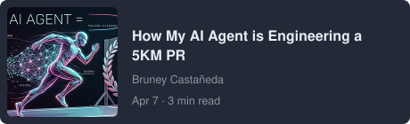
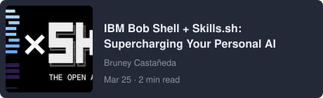
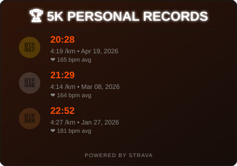
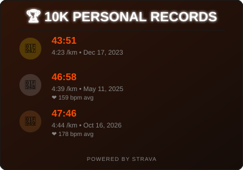
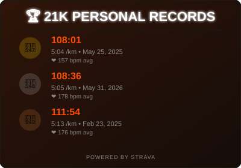
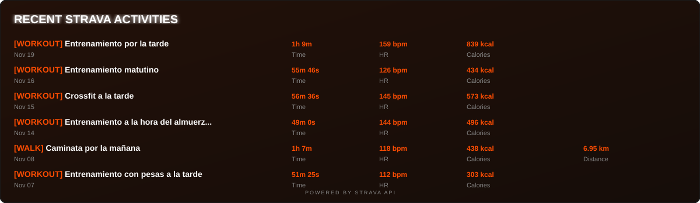

```aura width=1200 height=280
<div style={{
 width: '100%', height: '100%', background: 'linear-gradient(135deg, #0a0a0f 0%, #1a1a2e 100%)',
 display: 'flex', alignItems: 'center', fontFamily: 'Inter',
 position: 'relative', overflow: 'hidden', borderRadius: 16,
 border: '1px solid rgba(110,80,220,0.18)'
}}>

 <style>{`
 @keyframes float-slow {
 0%, 100% { transform: translateY(0px); opacity: 0.8; }
 50% { transform: translateY(-20px); opacity: 1.2; }
 }
 @keyframes float-medium {
 0%, 100% { transform: translateX(0px); opacity: 0.7; }
 50% { transform: translateX(-30px); opacity: 1.1; }
 }
 @keyframes pulse {
 0%, 100% { transform: scale(1); opacity: 0.6; }
 50% { transform: scale(1.2); opacity: 0.9; }
 }
 #glow-1 { animation: float-slow 8s ease-in-out infinite; }
 #glow-2 { animation: float-medium 12s ease-in-out infinite; }
 #glow-3 { animation: pulse 6s ease-in-out infinite; }
 `}</style>

 <svg width="1200" height="280" style={{ position: 'absolute', top: 0, left: 0 }}>
 <defs>
 <radialGradient id="g1" cx="50%" cy="50%" r="50%">
 <stop offset="0%" stopColor="rgba(110,20,210,0.5)" />
 <stop offset="70%" stopColor="rgba(90,15,180,0)" />
 </radialGradient>
 <radialGradient id="g2" cx="50%" cy="50%" r="50%">
 <stop offset="0%" stopColor="rgba(40,60,255,0.4)" />
 <stop offset="70%" stopColor="rgba(30,50,200,0)" />
 </radialGradient>
 <radialGradient id="g3" cx="50%" cy="50%" r="50%">
 <stop offset="0%" stopColor="rgba(0,190,230,0.3)" />
 <stop offset="70%" stopColor="rgba(0,190,230,0)" />
 </radialGradient>
 </defs>

 <ellipse id="glow-1" cx="200" cy="140" rx="300" ry="200" fill="url(#g1)" />
 <ellipse id="glow-2" cx="600" cy="140" rx="250" ry="180" fill="url(#g2)" />
 <ellipse id="glow-3" cx="1000" cy="140" rx="200" ry="150" fill="url(#g3)" />
 </svg>

 <div style={{ display:'flex', flexDirection:'column', marginLeft:60, gap:12, zIndex: 10, width: '100%' }}>
 <div style={{ display:'flex', fontSize:56, fontWeight:900, color:'#ffffff', letterSpacing:'-2px', lineHeight:1 }}>
 Edgar Bruney
 </div>
 <div style={{ display:'flex', fontSize:22, color:'rgba(180,165,255,0.9)', fontWeight:500, letterSpacing:'0.5px' }}>
 Agentic AI Engineer · Cloud Architect · Quantum Explorer
 </div>

 </div>
</div>
```


---

> ⚠️ **AI-Generated Disclaimer:** All information in this README was researched and written by an AI agent. It is automatically updated every day to keep data current. Content may not reflect real-time changes made outside of scheduled update cycles.

---

```aura width=1200 height=200
<div style={{
 width: '100%', height: '100%', background: 'linear-gradient(135deg, #0a0a0f 0%, #1a1a2e 100%)',
 display: 'flex', flexDirection: 'column', justifyContent: 'center', fontFamily: 'Inter',
 position: 'relative', overflow: 'hidden', borderRadius: 16,
 border: '1px solid rgba(110,80,220,0.18)', padding: '40px 60px'
}}>

 <style>{`
 @keyframes float-slow {
 0%, 100% { transform: translateY(0px); opacity: 0.8; }
 50% { transform: translateY(-20px); opacity: 1.2; }
 }
 #tech-glow { animation: float-slow 8s ease-in-out infinite; }
 `}</style>

 <svg width="1200" height="200" style={{ position: 'absolute', top: 0, left: 0 }}>
 <defs>
 <radialGradient id="tg1" cx="50%" cy="50%" r="50%">
 <stop offset="0%" stopColor="rgba(110,20,210,0.4)" />
 <stop offset="70%" stopColor="rgba(90,15,180,0)" />
 </radialGradient>
 </defs>
 <ellipse id="tech-glow" cx="600" cy="100" rx="400" ry="150" fill="url(#tg1)" />
 </svg>

 <div style={{ display:'flex', flexDirection:'column', gap: 20, zIndex: 10 }}>
 
 <div style={{ display:'flex', flexDirection:'column', gap: 8 }}>
 <div style={{ fontSize: 18, fontWeight: 700, color: 'rgba(180,165,255,0.95)', letterSpacing: '1px' }}>
 CORE
 </div>
 <div style={{ fontSize: 16, color: 'rgba(255,255,255,0.85)', fontWeight: 400, letterSpacing: '0.3px' }}>
 Java · TypeScript · Python · Node.js · React
 </div>
 </div>

 <div style={{ display:'flex', flexDirection:'column', gap: 8 }}>
 <div style={{ fontSize: 18, fontWeight: 700, color: 'rgba(180,165,255,0.95)', letterSpacing: '1px' }}>
 CLOUD
 </div>
 <div style={{ fontSize: 16, color: 'rgba(255,255,255,0.85)', fontWeight: 400, letterSpacing: '0.3px' }}>
 IBM Cloud · AWS · GCP · Docker · Linux
 </div>
 </div>

 <div style={{ display:'flex', flexDirection:'column', gap: 8 }}>
 <div style={{ fontSize: 18, fontWeight: 700, color: 'rgba(180,165,255,0.95)', letterSpacing: '1px' }}>
 AI LAB
 </div>
 <div style={{ fontSize: 16, color: 'rgba(255,255,255,0.85)', fontWeight: 400, letterSpacing: '0.3px' }}>
 IBM Watson · IBM Bob · BeeAI · Gemini · Claude
 </div>
 </div>

 </div>
</div>
```

---

### Professional Journey

**Edgar Bruney Castañeda** is an engineer at **IBM's CIO Organization** in **Zapopan, Jalisco, Mexico**, working at the intersection of **agentic AI** and **cloud architecture**. A GitHub member since **2013**, he turns research-grade AI into production systems: multi-agent pipelines with **BeeAI**, **CrewAI** and **LangGraph**, deployed as REST APIs with async jobs and live SSE streaming, with verify-and-retry orchestration loops.

His open-source work centers on quantum computing and autonomous agents. He built the **Quantum Lab Agent System** — a five-agent A2A network orchestrated by a central Lab Agent, powered by **IBM Granite 4.2 8B** via Ollama — with circuit visualization, live backend dashboards, a public project website on GitHub Pages (launched Nov 17, 2026), and QAOA Max-Cut experiments on real IBM Quantum hardware (`ibm_marrakesh`). He also published **[quantum-and-cybersecurity](https://github.com/BrUn3y/quantum-and-cybersecurity)**, an interactive workshop on quantum foundations, post-quantum cryptography and real-QPU Bell states.

He co-organizes **Quantum Guild GDL** and the **[Qiskit Fall Fest Guadalajara 2026](https://quantum-guild-gdl.github.io/qiskit_fall_fest_gdl/)**, a free two-day community quantum festival held **October 28–29, 2026**, streamed online in Spanish. The event site now shows a 60-photo gallery and the Day 1 and Day 2 recordings.

### Technical Expertise

Edgar holds multiple industry certifications:
- **IBM Generative & Agentic AI Expert Developer**
- **AWS Serverless Badge Holder**
- **Hybrid Cloud Microservices Architect**

His comprehensive technical stack includes:
- **AI/ML Frameworks:** BeeAI, CrewAI, LangGraph, Mellea (generative programming), AgentStack SDK, Harness SDK, Strands Agents SDK, A2A protocol, IBM Granite 4.2 8B (Ollama)
- **Cloud Platforms:** IBM Cloud, AWS, multi-cloud architecture design and implementation
- **Quantum Computing:** Qiskit, QASM 2.0/3.0, QAOA, VQE, Grover, Shor, Deutsch-Jozsa, QFT algorithms; Post-Quantum Cryptography (PQC) standards and migration; real-hardware execution on IBM Quantum; upstream contributor to Qiskit/qiskit-ibm-runtime (PRs #3426 and #3425 merged) and qiskit-addon-sqd (Sample-based Quantum Diagonalization); Agent Stack Canvas for circuit and topology visualization; hybrid quantum-classical multi-agent systems; Microsoft QDK (Q#, resource estimator, Quantum Katas) — upstream contributor via PR #3899 (notebook dependency completion coverage, Q# language service, open)
- **Integration Technologies:** REST API design, Docker containerization, Slack integration (Socket Mode), Strava API, Google Fit API, Huawei Health API, CLI-Hub public catalog (CLI-Anything, 66,405⭐)
- **Specializations:** Multi-agent pipelines with A2A, verify-and-retry orchestration, async jobs with live SSE streaming, enterprise AI deployment, Kubernetes agent sandboxing (DAM), IBM Consulting Advantage agent enablement, voice automation with Gemini Live, and remote terminal access (xTerm Remote Mode), and event-site engineering

### Featured Projects

- **[xTerm](https://github.com/BrUn3y/xTerm)** — New (Nov 23, 2026) desktop terminal built with Electron, React and TypeScript: split panes, file explorer, adaptive HARNESS panel showing live coding-agent activity, GitHub repo shortcut, foreground SSH sidebar and file drag and drop. Latest: **v0.6.1** (Nov 25, 2026) restores foreground coding-harness detection on macOS and Linux (sidebar harness card with model and activity, covered by a native PTY regression test); v0.6.0 added beta **Remote Mode** — check a running terminal or answer a coding agent from your phone via a single-use QR and Cloudflare tunnel (view-only or allow-commands, 1–5 hour access window); macOS arm64 DMG/ZIP and Linux AppImage with a [product website](https://brun3y.github.io/xTerm/).
- **[Qiskit Lab — DAM Starter Kit](https://github.com/BrUn3y/qiskit_lab)** — Qiskit SDK workspace for circuit development, local simulation, QAOA Max-Cut and IBM Quantum hardware jobs via `SamplerV2`. Latest: **v0.4.0** (Nov 11, 2026) with native CHSH experiments, durable results and bundled official Qiskit Agent Skills; follow-up releases on Nov 18 fixed the kit publisher metadata so it shows correctly in DAM catalogs. ([dam-starter-kits PR #18](https://github.com/dam-agents/dam-starter-kits/pull/18) merged Nov 18, 2026, so the kit is now in the DAM starter-kit catalog); the kit also has a public [website](https://brun3y.github.io/qiskit_lab/) with a DAM catalog walkthrough
- **[YT Vertical Mode](https://github.com/BrUn3y/yt-vertical-mode)** — Chrome and Dia extension that reframes YouTube videos for a portrait monitor with adjustable crop and framing. Latest: **v1.1.0** (Nov 13, 2026).
- **[Remote Bob](https://github.com/BrUn3y/remote_bob)** — Dockerized IBM Bob Shell harness over REST API with async jobs, live SSE streaming and Slack integration. Latest: **v1.0.4**.
- **[Gemini CLI Remote](https://github.com/BrUn3y/gemini_cli_remote)** — New (Nov 17, 2026) remote FastAPI harness for Google Gemini CLI with Slack, cancellable jobs, SSE streaming, verification retries and cron scheduling.
- **[AI Journey](https://github.com/BrUn3y/ai-journey)** — 15-slide Spanish presentation on AI agent evolution and the AI Software Factory (IBM Carbon styling).
- **[Qiskit Advocate Program](https://github.com/BrUn3y/qiskit-advocate-program)** — 18-slide Spanish deck on the Qiskit Advocate Program, tiers and point simulator.
- **[ICA Learning](https://github.com/BrUn3y/ica-learning)** — 12-slide Spanish deck on building agents with IBM Consulting Advantage.
- **[Quantum & Cybersecurity](https://github.com/BrUn3y/quantum-and-cybersecurity)** — Interactive workshop on quantum computing, post-quantum cryptography and Bell states on real hardware.
- **[Gemini Live to Pages](https://github.com/BrUn3y/IBM_Bob_Harness/tree/feat/google-drive-gemini-live)** — Speak a prompt to Gemini Live; Bob builds and publishes the site to GitHub Pages.
- **[BrUn3y.github.io](https://github.com/BrUn3y/BrUn3y.github.io)** — Personal site with Y2K aesthetics, live Spotify data and a custom radio player.
- **[TriForge](https://github.com/BrUn3y/triforge)** — Codex, Claude Code and IBM Bob Shell as an auditable multi-agent engineering council, now with an industrial-style [website](https://brun3y.github.io/triforge/) and interactive agent-loop architecture explorer.
- **[Quantum Lab Agent System](https://github.com/BrUn3y/quantum_lab_agent)** — Five-agent A2A workspace for IBM Quantum (Developer, Status, Computing, Experiment), now with an English [project website](https://brun3y.github.io/quantum_lab_agent/) (Nov 17, 2026).
- **[Strava Agent](https://github.com/BrUn3y/Strava_Agent)** — Conversational AI over the Strava API (BeeAI + AgentStack).
- **X Trends Agent** — Same trend-analysis agent in three frameworks: [BeeAI](https://github.com/BrUn3y/x_trends_agent_BeeAI) · [CrewAI](https://github.com/BrUn3y/x_trends_agent_CrewAI) · [LangGraph](https://github.com/BrUn3y/x_trends_agent_LangGraph).
- **[skills-ai-week](https://github.com/BrUn3y/skills-ai-week)** — Visual guide (in Spanish) on AI agent skills across Claude Code, Codex and IBM Bob.
- **Upstream contributions** — Merged: Qiskit/qiskit-ibm-runtime [PR #3426](https://github.com/Qiskit/qiskit-ibm-runtime/pull/3426) (Session/Batch timestamps), dam-agents/dam [PR #4287](https://github.com/dam-agents/dam/pull/4287) and [PR #4285](https://github.com/dam-agents/dam/pull/4285) (Hacktoberfest UI fixes), Mellea [PR #1676](https://github.com/generative-computing/mellea/pull/1676), hyperframes [PR #3930](https://github.com/heygen-com/hyperframes/pull/3930) (IBM Bob runtime), qiskit-ibm-runtime [PR #3425](https://github.com/Qiskit/qiskit-ibm-runtime/pull/3425) (reject NaN angles in `rzz` validation, Nov 26, 2026). Open: Microsoft QDK [PR #3899](https://github.com/microsoft/qdk/pull/3899), Omnigent [PR #8902](https://github.com/omnigent-ai/omnigent/pull/8902) (IBM Bob native TUI integration), CLI-Anything [PR #529](https://github.com/HKUDS/CLI-Anything/pull/529) (adds IBM Bob Shell to the CLI-Hub catalog; review requested Nov 19, still open). NASA Earthdata Search [PR #2099](https://github.com/nasa/earthdata-search/pull/2099) was closed; the fix continues via [issue #2098](https://github.com/nasa/earthdata-search/issues/2098) awaiting an EDSC number.
- **[NASA OpenMCT](https://github.com/BrUn3y/openmct)** — Fork with a fix for stale tooltip path requests (issue #6989).
- **[nxnative](https://github.com/BrUn3y/nxnative)** / **[rea](https://github.com/BrUn3y/rea)** — Forks exploring systems engineering: Switch-to-iOS translation and agent-driven reverse engineering.

### Beyond Code

- Co-organizer of **Quantum Guild GDL** and **Qiskit Fall Fest Guadalajara 2026** (Oct 28–29, 2026).
- Writes on **[Medium](https://medium.com/@brun3y)** about AI agents, athletic performance data and cloud tooling.
- Open-source contributor across 78 public repositories.

When stepping away from the screen, Edgar pursues his passion for **running** (actively training for a sub-21 minute 5K, tracking and analyzing every session with Python and AI tools) and enjoys **heavy music**. His application of AI technology to personal fitness optimization reflects his commitment to applying technology to personal growth.

`BeeAI · CrewAI · LangGraph` &nbsp;·&nbsp; `IBM Cloud` &nbsp;·&nbsp; `Qiskit` &nbsp;·&nbsp; `Running` &nbsp;·&nbsp; `Heavy Music`

---

<div align="center">


<br clear="right" />

</div>

---

### Open Source

- **[Remote Bob](https://github.com/BrUn3y/remote_bob)** (formerly IBM Bob Shell Harness; 26⭐, 5 forks) — Dockerized harness running IBM Bob Shell 2.0.5 headless in unrestricted mode, exposed over REST API with async jobs, live SSE streaming, Slack file attachments, and cancellable jobs (`DELETE /jobs/{id}`). Latest: **v1.0.4** (November 9, 2026).
- **[Strava Agent](https://github.com/BrUn3y/Strava_Agent)** (5⭐) — Advanced conversational AI system built with BeeAI framework and AgentStack SDK that analyzes athletic performance directly from the Strava API.
- **X Trends Agent** — Same trend-analysis agent, three frameworks: [BeeAI](https://github.com/BrUn3y/x_trends_agent_BeeAI) · [CrewAI](https://github.com/BrUn3y/x_trends_agent_CrewAI) · [LangGraph](https://github.com/BrUn3y/x_trends_agent_LangGraph).
- **[Quantum Lab Agent](https://github.com/BrUn3y/quantum_lab_agent)** / **[Quantum Experiment Agent](https://github.com/BrUn3y/quantum-experiment-agent)** — Quantum computing agents exploring AI and quantum circuits, including a hybrid agent powered by IBM Granite and AgentStack.
- **[hyperframes](https://github.com/BrUn3y/hyperframes)** — HTML-to-video renderer built for AI agents.
- **[strava-analytics](https://github.com/BrUn3y/strava-analytics)** — Python scripts to analyze running performance, CrossFit sessions, and calorie tracking from Strava.
- **Qiskit Contributions** — Active contributor to Qiskit/qiskit-ibm-runtime (244⭐, 235 forks) and qiskit-addon-sqd (102⭐, 49 forks), supporting the quantum computing community.

---

### On Medium

I write on [Medium](https://medium.com/@brun3y) about AI agents, athletic performance data, and cloud tooling.

<table>
 <tr>
 <td>
 <a href="https://medium.com/@brun3y/how-my-ai-agent-is-engineering-a-5km-pr-a2e9966869f4">
 
 </a>
 </td>
 <td>
 <a href="https://medium.com/@brun3y/ibm-bob-shell-skills-sh-supercharging-your-personal-ai-d074dbd5ec7c">
 
 </a>
 </td>
 </tr>
 <tr>
 <td>
 <a href="https://medium.com/@brun3y/i-finally-got-positive-results-following-my-strava-ai-agent-76ab080d8808">
 
 </a>
 </td>
 <td>
 <a href="https://medium.com/@brun3y/my-personal-ai-agent-for-strava-bdcb43d4fa3a">
 
 </a>
 </td>
 </tr>
</table>

---


---

### 🎧 Now Playing on Spotify

<div align="center">

[](https://github.com/kittinan/spotify-github-profile)

</div>

---

### 🏆 Strava Personal Records

<div align="center">





</div>



---

<div align="center">
<sub>ℹ️ Profile information collected and updated by AI assistant on November 27, 2026</sub>
</div>
