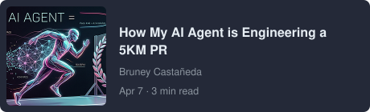
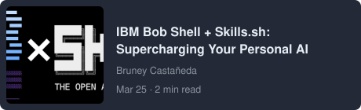
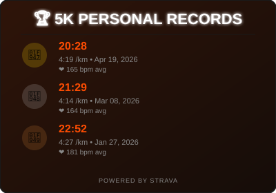
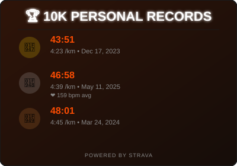
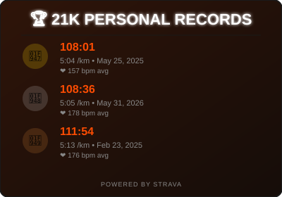
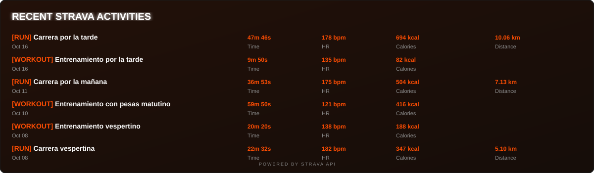

```aura width=1200 height=280
<div style={{
  width: '100%', height: '100%', background: 'linear-gradient(135deg, #0a0a0f 0%, #1a1a2e 100%)',
  display: 'flex', alignItems: 'center', fontFamily: 'Inter',
  position: 'relative', overflow: 'hidden', borderRadius: 16,
  border: '1px solid rgba(110,80,220,0.18)'
}}>

  <style>{`
      @keyframes float-slow {
        0%, 100% { transform: translateY(0px); opacity: 0.8; }
        50% { transform: translateY(-20px); opacity: 1.2; }
      }
      @keyframes float-medium {
        0%, 100% { transform: translateX(0px); opacity: 0.7; }
        50% { transform: translateX(-30px); opacity: 1.1; }
      }
      @keyframes pulse {
        0%, 100% { transform: scale(1); opacity: 0.6; }
        50% { transform: scale(1.2); opacity: 0.9; }
      }
      #glow-1 { animation: float-slow 8s ease-in-out infinite; }
      #glow-2 { animation: float-medium 12s ease-in-out infinite; }
      #glow-3 { animation: pulse 6s ease-in-out infinite; }
    `}</style>

  <svg width="1200" height="280" style={{ position: 'absolute', top: 0, left: 0 }}>
    <defs>
      <radialGradient id="g1" cx="50%" cy="50%" r="50%">
        <stop offset="0%" stopColor="rgba(110,20,210,0.5)" />
        <stop offset="70%" stopColor="rgba(90,15,180,0)" />
      </radialGradient>
      <radialGradient id="g2" cx="50%" cy="50%" r="50%">
        <stop offset="0%" stopColor="rgba(40,60,255,0.4)" />
        <stop offset="70%" stopColor="rgba(30,50,200,0)" />
      </radialGradient>
      <radialGradient id="g3" cx="50%" cy="50%" r="50%">
        <stop offset="0%" stopColor="rgba(0,190,230,0.3)" />
        <stop offset="70%" stopColor="rgba(0,190,230,0)" />
      </radialGradient>
    </defs>

    <ellipse id="glow-1" cx="200" cy="140" rx="300" ry="200" fill="url(#g1)" />
    <ellipse id="glow-2" cx="600" cy="140" rx="250" ry="180" fill="url(#g2)" />
    <ellipse id="glow-3" cx="1000" cy="140" rx="200" ry="150" fill="url(#g3)" />
  </svg>

  <div style={{ display:'flex', flexDirection:'column', marginLeft:60, gap:12, zIndex: 10, width: '100%' }}>
    <div style={{ display:'flex', fontSize:56, fontWeight:900, color:'#ffffff', letterSpacing:'-2px', lineHeight:1 }}>
      Edgar Bruney
    </div>
    <div style={{ display:'flex', fontSize:22, color:'rgba(180,165,255,0.9)', fontWeight:500, letterSpacing:'0.5px' }}>
      Agentic AI Engineer · Cloud Architect · Quantum Explorer
    </div>

  </div>
</div>
```


---

> ⚠️ **AI-Generated Disclaimer:** All information in this README was researched and written by an AI agent. It is automatically updated every day to keep data current. Content may not reflect real-time changes made outside of scheduled update cycles.

---

```aura width=1200 height=200
<div style={{
  width: '100%', height: '100%', background: 'linear-gradient(135deg, #0a0a0f 0%, #1a1a2e 100%)',
  display: 'flex', flexDirection: 'column', justifyContent: 'center', fontFamily: 'Inter',
  position: 'relative', overflow: 'hidden', borderRadius: 16,
  border: '1px solid rgba(110,80,220,0.18)', padding: '40px 60px'
}}>

  <style>{`
      @keyframes float-slow {
        0%, 100% { transform: translateY(0px); opacity: 0.8; }
        50% { transform: translateY(-20px); opacity: 1.2; }
      }
      #tech-glow { animation: float-slow 8s ease-in-out infinite; }
    `}</style>

  <svg width="1200" height="200" style={{ position: 'absolute', top: 0, left: 0 }}>
    <defs>
      <radialGradient id="tg1" cx="50%" cy="50%" r="50%">
        <stop offset="0%" stopColor="rgba(110,20,210,0.4)" />
        <stop offset="70%" stopColor="rgba(90,15,180,0)" />
      </radialGradient>
    </defs>
    <ellipse id="tech-glow" cx="600" cy="100" rx="400" ry="150" fill="url(#tg1)" />
  </svg>

  <div style={{ display:'flex', flexDirection:'column', gap: 20, zIndex: 10 }}>
    
    <div style={{ display:'flex', flexDirection:'column', gap: 8 }}>
      <div style={{ fontSize: 18, fontWeight: 700, color: 'rgba(180,165,255,0.95)', letterSpacing: '1px' }}>
        CORE
      </div>
      <div style={{ fontSize: 16, color: 'rgba(255,255,255,0.85)', fontWeight: 400, letterSpacing: '0.3px' }}>
        Java · TypeScript · Python · Node.js · React
      </div>
    </div>

    <div style={{ display:'flex', flexDirection:'column', gap: 8 }}>
      <div style={{ fontSize: 18, fontWeight: 700, color: 'rgba(180,165,255,0.95)', letterSpacing: '1px' }}>
        CLOUD
      </div>
      <div style={{ fontSize: 16, color: 'rgba(255,255,255,0.85)', fontWeight: 400, letterSpacing: '0.3px' }}>
        IBM Cloud · AWS · GCP · Docker · Linux
      </div>
    </div>

    <div style={{ display:'flex', flexDirection:'column', gap: 8 }}>
      <div style={{ fontSize: 18, fontWeight: 700, color: 'rgba(180,165,255,0.95)', letterSpacing: '1px' }}>
        AI LAB
      </div>
      <div style={{ fontSize: 16, color: 'rgba(255,255,255,0.85)', fontWeight: 400, letterSpacing: '0.3px' }}>
        IBM Watson · IBM Bob · BeeAI · Gemini · Claude
      </div>
    </div>

  </div>
</div>
```

---

### Professional Journey

**Edgar Bruney Castañeda** is an experienced engineer at **IBM's CIO Organization** in **Zapopan, Jalisco, Mexico**, specializing in translating research-grade AI into production systems. A GitHub member since **2013** with over 13 years of experience in the tech industry, he has built a distinguished career focused on cutting-edge technology implementation and open-source contribution.

Currently working at the intersection of **agentic AI development** and **cloud architecture**, Edgar designs and implements multi-agent pipelines using frameworks like **BeeAI**, **CrewAI**, and **LangGraph**. His work spans from concept to deployed REST APIs with async jobs and live SSE streaming, with emphasis on practical applications that solve real-world problems. He specializes in verify-and-retry orchestration loops and production-ready AI systems that bridge the gap between research and enterprise deployment, demonstrating a unique ability to transform research-grade AI into practical enterprise solutions.

His open-source work centers heavily on quantum computing and autonomous agent systems. He created the **Quantum Lab Agent System**: a five-agent A2A network — Developer, Status, Computing, and Experiment specialists — all orchestrated by a central Lab Agent and powered by **IBM Granite 4.2 8B** running locally via Ollama. The system features an Agent Stack Canvas integration for circuit visualization, live backend topology dashboards, and end-to-end QAOA Max-Cut experiments on real IBM Quantum hardware including `ibm_marrakesh`. In October 2026, he published **[quantum-and-cybersecurity](https://github.com/BrUn3y/quantum-and-cybersecurity)**, an interactive presentation and hands-on workshop hosted on [GitHub Pages](https://brun3y.github.io/quantum-and-cybersecurity/) exploring quantum computing foundations, post-quantum cryptography (PQC) standards, cryptographic migration strategies, and real-QPU Bell state generation with Qiskit. Through mid-October 2026 he continually enhanced the workshop — simplifying core explanations of quantum superposition and entanglement, clarifying cryptographic acronyms and mathematical foundations (symmetric vs. asymmetric encryption, NIST PQC standards), integrating a NotebookLM study guide and slide timing labels, adding PQC library references, simplifying the Shor's algorithm explanation, and streamlining the quantum-risk guidance slide — with the final polish landed on **October 15, 2026**.

Edgar is also a core organizer of **Quantum Guild GDL** (established August 17, 2026), a Guadalajara-based community co-organizing the **[Qiskit Fall Fest Guadalajara 2026](https://quantum-guild-gdl.github.io/qiskit_fall_fest_gdl/)** — a free, two-day community quantum computing festival held **October 28–29, 2026** (CST) with both days streamed **online** — the event has now **concluded**. All event content will be delivered in **Spanish** to support the regional Spanish-speaking quantum developer community. The festival features a two-track parallel schedule — a *Round Table for Decision Makers (Presencial Only)* running alongside main quantum computing sessions — Discord integration, and Luma ticketing. The site updates on **October 26, 2026** fixed swapped organizer photos (Alberto Treviño and Luis Toxtli), sorted all organizers alphabetically, and added five new organizers: **Joel Gonzales**, **Luis Toxtli**, **María Fernanda Chávez Colón**, **Alberto Adrián Treviño González**, and **Emmanuel Vazquez Pando**, bringing the full organizing team to ten members. On **October 26, 2026**, the session title for the 09:20–10:20 CST slot was updated to **"Cuántica + IA"**, highlighting the fusion of quantum computing and artificial intelligence as one of the core themes of the event. On **October 25, 2026**, an **Access & Check-in** item was added at 08:45–09:00 CST (in-person only) and the Round Table session received an **"Only Decision Makers"** label. Prior updates through October 23 added an **access video modal** to the venue section, aligned the venue buttons on a single row, removed a broken icon from the IBM SkillsBuild QR slide link, and introduced **registration deadlines** under each ticket tier (client-side auto-close logic). On **October 29, 2026**, the site moved into post-event mode: the Discord and "Get your ticket" buttons were removed, the hero text was rewritten in the past tense, and the Register section was replaced by a new **Gallery** section (marked "In Progress") added to the navbar. Earlier, on **October 27, 2026**, both Tier 1 and Tier 2 registrations were closed — the Luma links were removed and replaced with disabled **"Registro cerrado"** buttons, and the deadline text and auto-close scripts were dropped since registration is now permanently closed. On **October 21, 2026**, an **IBM SkillsBuild QR slide** (scene 7) was added, inviting attendees to join the free Quantum Computing Learning Plan (2 digital credentials, plan `PLAN-3793AAC77C46`). Headliner speakers include **Salvador E. Venegas-Andraca**, **Claudia Zendejas Morales**, and **Ismael Faro**.

Edgar's open-source contributions span major generative programming, agent orchestration, quantum ecosystems, and NASA open science. Across **Qiskit**, his **[PR #3426](https://github.com/Qiskit/qiskit-ibm-runtime/pull/3426)** (*"Expose timestamps in Session/Batch details()"*) to **[Qiskit/qiskit-ibm-runtime](https://github.com/Qiskit/qiskit-ibm-runtime)** was **merged on October 7, 2026**, exposing session transition timestamps in `Session.details()` and `Batch.details()`, while **[PR #3425](https://github.com/Qiskit/qiskit-ibm-runtime/pull/3425)** hardens `rzz` gate angle validation against `nan` values. For **IBM Hacktoberfest**, both of his UI bug-fix contributions to **[dam-agents/dam](https://github.com/dam-agents/dam)** were accepted and **merged**: **[PR #4287](https://github.com/dam-agents/dam/pull/4287)** (*merged October 3, 2026*) preventing React portal event bubbling during session deletions, and **[PR #4285](https://github.com/dam-agents/dam/pull/4285)** (*merged October 7, 2026*) retaining dialog content through the close animation. In the Microsoft quantum ecosystem, he submitted **[PR #3899](https://github.com/microsoft/qdk/pull/3899)** to **[microsoft/qdk](https://github.com/microsoft/qdk)** (open, Microsoft CLA signed October 12, 2026), adding Q# language-service completion test coverage for notebook package dependencies (closing issue #1768).

Additional upstream contributions include **[PR #1676](https://github.com/generative-computing/mellea/pull/1676)** to **[generative-computing/mellea](https://github.com/generative-computing/mellea)** (**merged September 28, 2026** for dynamic OpenAI adapter deregistration) and **[PR #3930](https://github.com/heygen-com/hyperframes/pull/3930)** to **[heygen-com/hyperframes](https://github.com/heygen-com/hyperframes)** (**merged September 22, 2026** adding IBM Bob Shell runtime support). Edgar also published **[TriForge](https://github.com/BrUn3y/triforge)** on **September 23, 2026** — orchestrating Codex, Claude Code, and IBM Bob Shell into an auditable multi-agent engineering council. On **September 24, 2026**, Edgar forked **[strands-agents/harness-sdk](https://github.com/strands-agents/harness-sdk)** (8,987⭐, 1,448 forks) — the open-source Python & TypeScript SDK for building production AI agent harnesses across any model and cloud — signalling interest in contributing to the Strands Agents ecosystem. On **October 12, 2026**, Edgar forked **[NASA Earthdata Search](https://github.com/nasa/earthdata-search)** (828⭐, 261 forks) — NASA EOSDIS's web application for Earth science data discovery — and opened **[PR #2099](https://github.com/nasa/earthdata-search/pull/2099)** (*"Fixes typos in SWODLR access method and tooltip text"*), correcting user-facing spelling errors in the SWODLR access method and constants, linked to issue #2098. On **October 16, 2026**, he forked **[morluto/rea](https://github.com/BrUn3y/rea)** — an agent-driven reverse-engineering project for working from app behavior down to native binaries — expanding his exploration of agentic AI tooling. On **October 23, 2026**, Edgar published **[skills-ai-week](https://github.com/BrUn3y/skills-ai-week)** — a comprehensive visual guide (in Spanish) explaining how AI agent skills work across Claude Code, Codex, and IBM Bob, created with Archify. The guide features four interactive Mermaid diagrams covering the skill activation lifecycle, file structure, framework comparisons, and an agent decision tree. On **October 25, 2026**, Edgar forked **[seedds/nxnative](https://github.com/seedds/nxnative)** (9,087⭐, 1,449 forks) — a cutting-edge project that converts Nintendo Switch game packages (NSP files) into unsigned IPAs capable of running natively on iPhone, iPad, and Mac via an NSO rewriter, Horizon HLE host, and NVN-to-Metal translation layer — expanding his portfolio into systems-level mobile and gaming engineering. On **October 26, 2026**, Edgar launched **[BrUn3y.github.io](https://github.com/BrUn3y/BrUn3y.github.io)** — his new personal website (live at [brun3y.github.io](https://brun3y.github.io/)) built with Y2K aesthetics, featuring AI agents, quantum computing content, and a custom **BRUN3YAMP** music player. The site integrates live Spotify data and is actively maintained with daily automated updates. By **October 27, 2026**, he had replaced the original Spotify widget with an in-house **Cyber Music Lover Radio** player featuring animated playback bars and live song display, and on October 27, 2026 added a rotating retro globe with decorative signals, an IRC-style retro chat (`brun3y` channel) with radio chatter and an unread-message indicator, classic web buttons under the Open Source sidebar, and retro forum share-image metadata.

### Technical Expertise

Edgar holds multiple industry certifications:
- **IBM Generative & Agentic AI Expert Developer**
- **AWS Serverless Badge Holder**
- **Hybrid Cloud Microservices Architect**

His comprehensive technical stack includes:
- **AI/ML Frameworks:** BeeAI, CrewAI, LangGraph, Mellea (generative programming), AgentStack SDK, Harness SDK, Strands Agents SDK, A2A protocol, IBM Granite 4.2 8B (Ollama)
- **Cloud Platforms:** IBM Cloud, AWS, multi-cloud architecture design and implementation
- **Quantum Computing:** Qiskit, QASM 2.0/3.0, QAOA, VQE, Grover, Shor, Deutsch-Jozsa, QFT algorithms; Post-Quantum Cryptography (PQC) standards and migration; real-hardware execution on IBM Quantum; upstream contributor to Qiskit/qiskit-ibm-runtime (PR #3426 merged, PR #3425) and qiskit-addon-sqd (Sample-based Quantum Diagonalization); Agent Stack Canvas for circuit and topology visualization; hybrid quantum-classical multi-agent systems; Microsoft QDK (Q#, resource estimator, Quantum Katas) — upstream contributor via PR #3899 (notebook dependency completion coverage, Q# language service, open)
- **Integration Technologies:** REST API design, Docker containerization, Slack integration (Socket Mode), Strava API, Google Fit API, Huawei Health API, CLI-Hub public catalog (CLI-Anything, 57,587⭐)
- **Specializations:** Multi-agent pipeline design with A2A protocol, verify-and-retry orchestration loops, async jobs with live SSE streaming, enterprise AI deployment, generative programming and backend adapter management (Mellea), HTML-to-video rendering for agents (hyperframes / HeyGen), Kubernetes agent sandboxing (DAM platform — PRs #4285 and #4287 merged), multi-agent peer-review orchestration (TriForge), interactive architecture diagram generation (Archify), React/TypeScript UI engineering (dam-agents/dam), native TUI harness integration (Omnigent meta-harness, 11,100⭐), CLI catalog registration (HKUDS/CLI-Anything, 57,587⭐), production agent harness engineering (strands-agents/harness-sdk), NASA Earth science data platform contributions (earthdata-search, 828⭐), systems-level mobile/gaming engineering (nxnative fork — Switch-to-iOS NVN to Metal), personal website development and creative front-end (BrUn3y.github.io, Y2K aesthetics)

### Featured Projects

**[BrUn3y.github.io — Personal Website](https://github.com/BrUn3y/BrUn3y.github.io)** — Launched on **October 26, 2026**, this is Edgar's new personal website (live at [brun3y.github.io](https://brun3y.github.io/)) built with Y2K aesthetics, featuring content on AI agents, quantum computing, and open source. It ships a custom **BRUN3YAMP** Spotify player, and by October 27, 2026 was upgraded to a full **Cyber Music Lover Radio** player with animated playback bars showing the current live song. The site is fully automated with daily data refreshes and is the canonical home for Edgar's public presence.

**[Quantum & Cybersecurity Interactive Workshop](https://github.com/BrUn3y/quantum-and-cybersecurity)** — An interactive educational slide deck and hands-on workshop deployed on [GitHub Pages](https://brun3y.github.io/quantum-and-cybersecurity/). It covers quantum computing principles, the threat posed by quantum algorithms (Shor's, Grover's) to public-key cryptography (RSA, ECC), NIST Post-Quantum Cryptography (PQC) standards (ML-KEM, ML-DSA, SLH-DSA), and cryptographic migration roadmaps. Features simplified explanations of superposition and entanglement, clarified cryptographic acronyms and mathematical foundations, a NotebookLM study guide, and an interactive Jupyter notebook workshop for Bell state generation using Qiskit, simulating the circuit, and dispatching execution to real IBM Quantum hardware.

**[Qiskit/qiskit-ibm-runtime Contributions](https://github.com/Qiskit/qiskit-ibm-runtime)** (239⭐, 232 forks) — Active upstream contributions to IBM Quantum's runtime client. **[PR #3426](https://github.com/Qiskit/qiskit-ibm-runtime/pull/3426)** (*"Expose timestamps in Session/Batch details()"*) was **merged on October 7, 2026**, exposing the backend state-transition `timestamps` list in dictionaries returned by `Session.details()` and `Batch.details()`. **[PR #3425](https://github.com/Qiskit/qiskit-ibm-runtime/pull/3425)** (*"Reject nan angles in rzz validation"*) hardens `rzz` gate angle validation to reject `nan`/non-finite inputs with `IBMInputValueError`.

**[dam-agents/dam Contributions](https://github.com/dam-agents/dam)** (33⭐, 13 forks) — As part of **IBM Hacktoberfest**, Edgar contributed two critical UI fixes that are both **merged** into core: **[PR #4287](https://github.com/dam-agents/dam/pull/4287)** (*merged October 3, 2026*) stopped React portal event bubbling during inactive session deletion, and **[PR #4285](https://github.com/dam-agents/dam/pull/4285)** (*merged October 7, 2026*) preserved dialog content through exit transitions to eliminate content flash on modal close.

**[Microsoft QDK Upstream Contribution](https://github.com/microsoft/qdk)** (1,027⭐, 220 forks) — Edgar submitted **[PR #3899](https://github.com/microsoft/qdk/pull/3899)** (*"Add notebook dependency completion coverage"*) to the official Microsoft Quantum Development Kit repository, currently open for review. The PR closes issue #1768 by adding integration test coverage for completions in Q# notebooks connected to project package dependencies within the `qsls` (Q# Language Service) crate.

**[TriForge](https://github.com/BrUn3y/triforge)** — A reusable GitHub template published on September 23, 2026 that orchestrates Codex, Claude Code, and IBM Bob Shell as an *auditable engineering council*. All three agents consult in parallel, one implements, and the other two review independently — nothing ships without unanimous approval. The project ships with a Python `agent_loop` coordinator, animated communication demo, full test suite, and an [interactive Archify architecture diagram](https://brun3y.github.io/triforge/) on GitHub Pages. Every handoff is persisted in `live.log` and `transcript.jsonl` for complete auditability. Built with Python, `.bob/`, `.claude/`, and `.codex/` configuration layers side-by-side.

**[IBM Bob Shell Harness](https://github.com/BrUn3y/IBM_Bob_Harness)** (26⭐, 5 forks) — A Dockerized harness running IBM's Bob Shell headless in unrestricted mode, exposed via REST API with async jobs and live SSE streaming. Features Slack integration for autonomous AI operations with verify-and-retry orchestration loops. Released **v1.0.3** on **October 9, 2026** — upgrading the container to **IBM Bob Shell 2.0.5**, pinning Node.js to 24.21.0 with SHA-256 tarball verification, disabling runtime auto-updates for reproducible builds, adding Slack file attachment handling with persisted thread context and upload quota controls, adding `DELETE /jobs/{id}` cancellation, and bumping the REST API to **version 1.4.0**. Ships with workshop documentation plus Postman and OpenAPI examples. The harness itself was actively used to merge pull requests and commit changes to the Qiskit Fall Fest Guadalajara site, demonstrating its real-world autonomous capabilities in production.

**[Mellea Contributions](https://github.com/generative-computing/mellea)** (1,844⭐, 176 forks) — On September 24, 2026, Edgar submitted **[PR #1676](https://github.com/generative-computing/mellea/pull/1676)** (*"fix: add OpenAI adapter deregistration"*) to `generative-computing/mellea`, introducing `OpenAIBackend.remove_adapter()` to enable dynamic adapter deregistration, cache invalidation, and qualified name recycling under concurrency locks. The PR was **merged on September 28, 2026**, making the adapter deregistration feature part of Mellea's upstream codebase.

**[hyperframes](https://github.com/BrUn3y/hyperframes)** — Edgar's fork of the **[HeyGen hyperframes](https://github.com/heygen-com/hyperframes)** project (74,778⭐, 6,798 forks), a framework for writing HTML and rendering it as video — purpose-built for AI agents. On September 14, 2026, Edgar submitted **[PR #3930](https://github.com/heygen-com/hyperframes/pull/3930)** upstream to add IBM Bob runtime support to the HyperFrames CLI. The PR was **merged on September 22, 2026** by maintainer `jrusso1020`, integrating IBM Bob Shell into HyperFrames as a first-class supported coding-agent runtime.

**[Quantum Lab Agent System](https://github.com/BrUn3y/quantum_lab_agent)** — A complete five-agent multi-agent workspace for IBM Quantum, built entirely with the A2A protocol and IBM Granite 4.2 8B. The orchestrator (`quantum_lab_agent`, port 8000) coordinates four specialist agents: a [Quantum Developer Agent](https://github.com/BrUn3y/quantum-developer-agent) for code generation (Grover, Shor, Deutsch-Jozsa, QFT...), a [Quantum Status Agent](https://github.com/BrUn3y/quantum-status-agent) for real-time backend monitoring and chip topology Canvas visualization, a [Quantum Computing Agent](https://github.com/BrUn3y/quantum-computing-agent) for circuit execution on simulators and real IBM Quantum hardware, and the [Quantum Experiment Agent](https://github.com/BrUn3y/quantum-experiment-agent) for hybrid QAOA/VQE experiments (QAOA Max-Cut for 2–8 node graphs on `ibm_marrakesh`).

**[Strava Agent](https://github.com/BrUn3y/Strava_Agent)** (5⭐, 1 fork) — An advanced conversational AI system built with BeeAI framework and AgentStack SDK that analyzes athletic performance directly from the Strava API. Features full A2A protocol support, AgentStack Server RESTful endpoints, and five organized agent skills for multi-agent integration. Complemented by [strava-analytics](https://github.com/BrUn3y/strava-analytics), a Python toolkit for analyzing running performance, CrossFit sessions, and calorie tracking.

**X Trends Agent** — A trend-analysis agent implemented across three different frameworks ([BeeAI](https://github.com/BrUn3y/x_trends_agent_BeeAI), [CrewAI](https://github.com/BrUn3y/x_trends_agent_CrewAI), [LangGraph](https://github.com/BrUn3y/x_trends_agent_LangGraph)), demonstrating framework-agnostic agent engineering capabilities and deep understanding of different AI architectures.

**[NASA OpenMCT](https://github.com/BrUn3y/openmct)** — On September 28, 2026, Edgar forked the **[NASA OpenMCT](https://github.com/nasa/openmct)** project (13,195⭐, 1,498 forks) — NASA's web-based mission control framework powering space operations and data visualization — and created branch `mct6989` to contribute a fix for stale tooltip path requests (issue #6989). The patch invalidates pending asynchronous path lookups when the pointer leaves a tooltip target or its component unmounts, with regression test coverage for the search result race condition.

**[NASA Earthdata Search](https://github.com/BrUn3y/earthdata-search)** — On **October 12, 2026**, Edgar forked **[NASA/earthdata-search](https://github.com/nasa/earthdata-search)** (828⭐, 261 forks) — NASA EOSDIS's web application for Earth science data discovery, search, comparison, visualization, and download across the full NASA data catalog. Edgar opened **[PR #2099](https://github.com/nasa/earthdata-search/pull/2099)** (*"Fixes typos in SWODLR access method and tooltip text"*), linked to issue #2098, correcting user-facing spelling errors (`avaliable` to `available`, `stich` to `stitch`, `L@_HR_Raster` to `L2_HR_Raster`) in the SWODLR access method UI and tooltip constants.

**[HKUDS/CLI-Anything](https://github.com/HKUDS/CLI-Anything)** (57,587⭐, 5,182 forks) — On **October 2, 2026**, Edgar submitted **[PR #529](https://github.com/HKUDS/CLI-Anything/pull/529)** (*"feat(registry): add IBM Bob Shell to public catalog"*) to the CLI-Hub public catalog, registering IBM Bob Shell v2.0.5 as a discoverable and installable AI tool. The entry includes the official install script, Node.js 24+ requirements, and documentation links.

**[omnigent-ai/omnigent](https://github.com/omnigent-ai/omnigent)** (11,100⭐, 1,826 forks) — Edgar forked the Omnigent AI agent meta-harness on **October 2, 2026** and submitted **[PR #8902](https://github.com/omnigent-ai/omnigent/pull/8902)** (*"feat(harness): add IBM Bob native TUI integration"*), implementing `bob-native`: a terminal-first native harness that launches `bob chat` in a runner-owned tmux pane and mirrors Omnigent web-composer messages into Bob's input. The implementation follows the same registry seam as Kiro, Goose, and Qwen, with full provider rows, capability entries, readiness/install metadata, and dialog fail-closed handling for Bob's folder-trust and tool-approval prompts.

**[strands-agents/harness-sdk](https://github.com/strands-agents/harness-sdk)** (8,987⭐, 1,448 forks) — On **September 24, 2026**, Edgar forked the Strands Agents Harness SDK — an open-source Python & TypeScript framework for building production AI agent harnesses across any model and any cloud (Anthropic, OpenAI, AWS Bedrock, and more). The fork signals Edgar's exploration of the Strands Agents ecosystem as a complement to his existing multi-agent toolchain.

**[nxnative](https://github.com/BrUn3y/nxnative)** — On **October 25, 2026**, Edgar forked **[seedds/nxnative](https://github.com/seedds/nxnative)** (9,087⭐, 1,449 forks) — a project that converts Nintendo Switch NSP packages into unsigned IPAs that run natively on iPhone, iPad, and Mac, via an NSO binary rewriter, a Horizon OS High-Level Emulation (HLE) host, and a complete NVN-to-Metal graphics translation layer. The fork demonstrates Edgar's interest in low-level systems engineering, mobile runtime environments, and binary translation at the intersection of gaming and platform hacking.

**[skills-ai-week](https://github.com/BrUn3y/skills-ai-week)** — Published on **October 23, 2026**, this is a comprehensive visual guide (in Spanish) explaining how AI agent skills work across Claude Code, Codex, and IBM Bob, created with Archify. The guide includes four interactive Mermaid diagrams covering the skill activation lifecycle, file structure, framework comparisons, and an agent decision tree. It also features installation walkthroughs (local and global), Markdown technique references, a downloadable skill template, and a curated list of repositories. The static site is deployed on [GitHub Pages](https://brun3y.github.io/skills-ai-week/) and produced as part of AI Week educational content.

### Beyond Code

Edgar is actively engaged in the tech community with significant leadership and educational initiatives:

- **Starred ismaelfaro/Spooktacle** — on **October 30, 2026**, Edgar starred **[ismaelfaro/Spooktacle](https://github.com/ismaelfaro/Spooktacle)** — a browser-based video mapping tool created the same day by **Ismael Faro** (ANFAIA President, ex-IBM Distinguished Engineer, and co-creator of Qiskit). The engagement reflects Edgar's ongoing connection with the Qiskit/IBM quantum community and his interest in creative browser-based visualization tools.
- **Personal website continues daily automated updates** — on **October 29–31, 2026**, Edgar's personal site **[brun3y.github.io](https://brun3y.github.io/)** continued receiving automated daily data refreshes ("Refresh public website activity snapshots"), confirming the fully automated pipeline that keeps his public presence current without manual intervention.
- **Qiskit Fall Fest Guadalajara 2026 concluded** — on **October 29, 2026**, the two-day festival co-organized by Edgar through Quantum Guild GDL wrapped up. The same day the event site was switched to post-event mode (Discord and ticket buttons removed, hero copy in past tense) and a **Gallery** section was introduced in place of registration, currently marked "In Progress".
- **Starred ANFAIA/QUMO** — on **October 28, 2026**, Edgar starred **[ANFAIA/QUMO](https://github.com/ANFAIA/QUMO)** (*Quantum Utilities for Modern Outcomes*), continuing his engagement with the open quantum software ecosystem on the opening day of Qiskit Fall Fest Guadalajara 2026.
- **Launched personal website BrUn3y.github.io** — on **October 26, 2026**, Edgar launched **[BrUn3y.github.io](https://github.com/BrUn3y/BrUn3y.github.io)** — his new personal site live at [brun3y.github.io](https://brun3y.github.io/), built with Y2K aesthetics and featuring AI agents, quantum computing, and open source content. On **October 27, 2026**, he replaced the Spotify widget with a custom **Cyber Music Lover Radio** player that shows the current radio song with animated playback bars. The same day he also added a rotating retro globe, an IRC-style retro chat with radio chatter and unread indicator, and classic web buttons to the sidebar. The site is actively maintained with daily automated updates.
- **Forked nxnative** — on **October 25, 2026**, Edgar forked **[seedds/nxnative](https://github.com/seedds/nxnative)** (9,087⭐, 1,449 forks) — a project for running Nintendo Switch games natively on iPhone, iPad, and Mac through NSP-to-IPA conversion, an NSO rewriter, Horizon HLE host, and NVN to Metal graphics translation — exploring systems-level low-level binary engineering at the intersection of gaming and mobile platforms.
- **Qiskit Fall Fest Guadalajara 2026 — October 28–29** — The **[Qiskit Fall Fest Guadalajara 2026](https://quantum-guild-gdl.github.io/qiskit_fall_fest_gdl/)** that Edgar co-organizes through **Quantum Guild GDL** ran **October 28–29, 2026** (CST), both days streamed **online** in **Spanish**. On **October 26, 2026**, the organizing team expanded to ten members with the addition of Joel Gonzales, Luis Toxtli, María Fernanda Chávez Colón, Alberto Adrián Treviño González, and Emmanuel Vazquez Pando; organizer photos were corrected; all organizers sorted alphabetically; and the 09:20 session was retitled **"Cuántica + IA"**. On **October 25, 2026**, an Access & Check-in item was added at 08:45 CST and the Round Table session was labeled for decision makers only. On **October 27, 2026**, Tier 1 and Tier 2 registration were both closed (Luma links replaced by disabled "Registro cerrado" buttons). Earlier updates added registration deadlines, an IBM SkillsBuild QR slide, headliner speakers (Salvador E. Venegas-Andraca, Claudia Zendejas Morales, Ismael Faro), and a streamlined two-track agenda.
- **Published skills-ai-week visual guide** — on **October 23, 2026**, Edgar published **[skills-ai-week](https://github.com/BrUn3y/skills-ai-week)** — a comprehensive interactive visual guide (in Spanish) covering how AI agent skills work across Claude Code, Codex, and IBM Bob, built with Archify. The guide features four interactive Mermaid diagrams (activation lifecycle, file structure, framework comparison, decision tree), installation walkthroughs, Markdown technique references, and a downloadable skill template. The site is live at [GitHub Pages](https://brun3y.github.io/skills-ai-week/), produced as part of AI Week educational content.
- **Starred OpenCommunityEdition/OpenCE** — on **October 19, 2026**, Edgar starred **[OpenCommunityEdition/OpenCE](https://github.com/OpenCommunityEdition/OpenCE)** (1,842⭐, 269 forks) — the open-source port of *Halo: Combat Evolved* (original Xbox) to Windows, Linux, and Android — reflecting his broader interests in open-source systems programming and classic game preservation.
- **Forked morluto/rea** — on **October 16, 2026**, Edgar forked **[morluto/rea](https://github.com/BrUn3y/rea)**, an agent-driven reverse-engineering project ("reverse engineer anything with agents, from app behavior down to native binaries"), expanding his agentic AI tooling and binary reverse-engineering workflows.
- **Refined Quantum & Cybersecurity Interactive Workshop** — on **October 14–15, 2026**, Edgar enhanced **[quantum-and-cybersecurity](https://github.com/BrUn3y/quantum-and-cybersecurity)** interactive slides with simplified explanations of quantum superposition and entanglement, clarified cryptographic acronyms and mathematical foundations (symmetric vs. asymmetric cryptography, NIST PQC standards like ML-KEM, ML-DSA, and SLH-DSA), added PQC library references to the standards slide, simplified the Shor's algorithm explanation, updated the PQC slide title, and streamlined the quantum-risk guidance slide. Earlier in October, he integrated NIST reference links, a NotebookLM study guide, slide timing labels, updated workshop links, and reorganized Bell state resources ahead of Qiskit Fall Fest Guadalajara 2026.
- **Forked NASA Earthdata Search & opened PR #2099** — on **October 12, 2026**, Edgar forked **[NASA/earthdata-search](https://github.com/nasa/earthdata-search)** (828⭐) and submitted **[PR #2099](https://github.com/nasa/earthdata-search/pull/2099)** (*"Fixes typos in SWODLR access method and tooltip text"*), correcting user-facing spelling errors in the SWODLR access method details and tooltip constants, linked to issue #2098.
- **Resolved DuckDuckGo Search Tooling in BeeAI Agent** — on **October 12, 2026**, closed issue #1 in **[x_trends_agent_BeeAI](https://github.com/BrUn3y/x_trends_agent_BeeAI)** addressing search tool rate-limiting and error handling in multi-agent trend workflows.
- **Launched Quantum & Cybersecurity Interactive Presentation** — in October 2026, Edgar published **[quantum-and-cybersecurity](https://github.com/BrUn3y/quantum-and-cybersecurity)** with a companion [interactive presentation](https://brun3y.github.io/quantum-and-cybersecurity/) exploring quantum physics fundamentals, post-quantum cryptography (NIST ML-KEM, ML-DSA, SLH-DSA), cryptographic inventory/discovery, and a hands-on Qiskit Bell state workshop on IBM Quantum hardware.
- **Merged PR #3426 into Qiskit/qiskit-ibm-runtime** — on **October 7, 2026**, **[PR #3426](https://github.com/Qiskit/qiskit-ibm-runtime/pull/3426)** (*"Expose timestamps in Session/Batch details()"*) was **merged** into upstream `Qiskit/qiskit-ibm-runtime`, exposing session state-transition timestamps in `Session.details()` and `Batch.details()`.
- **Both IBM Hacktoberfest PRs merged into dam-agents/dam** — on **October 7, 2026**, **[PR #4285](https://github.com/dam-agents/dam/pull/4285)** (*"fix(ui): keep dialog content through close animation"*) was **merged**, joining **[PR #4287](https://github.com/dam-agents/dam/pull/4287)** (*"fix(ui): keep active session when deleting another"*, **merged October 3, 2026**). Both of Edgar's UI bug-fix contributions to the DAM agent sandboxing platform have now been accepted into the codebase.
- **Microsoft QDK PR #3899 open, actively engaged** — on **October 6, 2026**, Edgar submitted **[PR #3899](https://github.com/microsoft/qdk/pull/3899)** (*"Add notebook dependency completion coverage"*) to the upstream `microsoft/qdk` repository — his first direct contribution to Microsoft's Quantum Development Kit, currently open and closing issue #1768 in the `qsls` crate. He signed the Microsoft CLA on the PR on **October 12, 2026**, clearing the way for maintainer review.
- **Qiskit/qiskit-ibm-runtime PR #3425** — on **October 2, 2026**, Edgar submitted **[PR #3425](https://github.com/Qiskit/qiskit-ibm-runtime/pull/3425)** to harden `rzz` gate validation against `nan` angles.
- **IBM Bob Shell in Omnigent & CLI-Hub** — on **October 2, 2026**, Edgar submitted **[PR #8902](https://github.com/omnigent-ai/omnigent/pull/8902)** to `omnigent-ai/omnigent` adding native IBM Bob TUI support and **[PR #529](https://github.com/HKUDS/CLI-Anything/pull/529)** to `HKUDS/CLI-Anything` registering IBM Bob Shell v2.0.5 in the public catalog.
- **Released IBM Bob Shell Harness v1.0.3** — on **October 9, 2026**, Edgar released **[v1.0.3](https://github.com/BrUn3y/IBM_Bob_Harness/releases/tag/v1.0.3)** of the IBM Bob Shell Harness, upgrading the container to **IBM Bob Shell 2.0.5** with Node.js 24.21.0 pinning, SHA-256 tarball integrity verification, runtime auto-update disabling for reproducible builds, Slack file attachment support with persisted thread context and quota controls, a new `DELETE /jobs/{id}` cancellation endpoint, and REST API bumped to **v1.4.0**. All 105 offline pytest tests pass.
- **Co-organizing Quantum Guild GDL & Qiskit Fall Fest GDL 2026** — founded August 17, 2026, the guild drives the **[Qiskit Fall Fest Guadalajara 2026](https://quantum-guild-gdl.github.io/qiskit_fall_fest_gdl/)** : a free, community-run quantum computing festival held **October 28–29, 2026** (CST), both days streamed **online** in **Spanish**, and now concluded.
- **Published TriForge** — on **September 23, 2026**, Edgar launched **[TriForge](https://github.com/BrUn3y/triforge)**, a multi-agent engineering council template orchestrating Codex, Claude Code, and IBM Bob Shell with an [interactive architecture diagram](https://brun3y.github.io/triforge/) powered by Archify.
- **Merged into Mellea & HyperFrames** — **[PR #1676](https://github.com/generative-computing/mellea/pull/1676)** to `generative-computing/mellea` (merged September 28, 2026) and **[PR #3930](https://github.com/heygen-com/hyperframes/pull/3930)** to `heygen-com/hyperframes` (merged September 22, 2026).
- **Forked strands-agents/harness-sdk** — on **September 24, 2026**, Edgar forked the [Strands Agents Harness SDK](https://github.com/strands-agents/harness-sdk) (8,987⭐), exploring the framework for production AI agent development across any model and cloud.
- **Writing on [Medium](https://medium.com/@brun3y)** about AI agents, athletic performance data, and cloud tooling.
- **Open-source contributions** across 68 public repositories on GitHub, demonstrating continuous participation in the developer community and collaborative open-source engineering.
- **Community building** on GitHub with 22 followers and 33 following, maintaining connections across the global tech ecosystem and fostering knowledge exchange.

When stepping away from the screen, Edgar pursues his passion for **running** (actively training for a sub-21 minute 5K, tracking and analyzing every session with Python and AI tools) and enjoys **heavy music**. His application of AI technology to personal fitness optimization reflects his commitment to applying technology to personal growth.

`BeeAI · CrewAI · LangGraph` &nbsp;·&nbsp; `IBM Cloud` &nbsp;·&nbsp; `Qiskit` &nbsp;·&nbsp; `Running` &nbsp;·&nbsp; `Heavy Music`

---

<div align="center">


<br clear="right" />

</div>

---

### Open Source

- **[IBM Bob Shell Harness](https://github.com/BrUn3y/IBM_Bob_Harness)** (26⭐, 5 forks) — Dockerized harness running IBM Bob Shell 2.0.5 headless in unrestricted mode, exposed over REST API v1.4.0 with async jobs, live SSE streaming, Slack file attachments, and cancellable jobs (`DELETE /jobs/{id}`). Latest: **v1.0.3** (October 9, 2026).
- **[Strava Agent](https://github.com/BrUn3y/Strava_Agent)** (5⭐) — Advanced conversational AI system built with BeeAI framework and AgentStack SDK that analyzes athletic performance directly from the Strava API.
- **X Trends Agent** — Same trend-analysis agent, three frameworks: [BeeAI](https://github.com/BrUn3y/x_trends_agent_BeeAI) · [CrewAI](https://github.com/BrUn3y/x_trends_agent_CrewAI) · [LangGraph](https://github.com/BrUn3y/x_trends_agent_LangGraph).
- **[Quantum Lab Agent](https://github.com/BrUn3y/quantum_lab_agent)** / **[Quantum Experiment Agent](https://github.com/BrUn3y/quantum-experiment-agent)** — Quantum computing agents exploring AI and quantum circuits, including a hybrid agent powered by IBM Granite and AgentStack.
- **[hyperframes](https://github.com/BrUn3y/hyperframes)** — HTML-to-video renderer built for AI agents.
- **[strava-analytics](https://github.com/BrUn3y/strava-analytics)** — Python scripts to analyze running performance, CrossFit sessions, and calorie tracking from Strava.
- **Qiskit Contributions** — Active contributor to Qiskit/qiskit-ibm-runtime (239⭐, 232 forks) and qiskit-addon-sqd (102⭐, 45 forks), supporting the quantum computing community.

---

### On Medium

I write on [Medium](https://medium.com/@brun3y) about AI agents, athletic performance data, and cloud tooling.

<table>
  <tr>
    <td>
      <a href="https://medium.com/@brun3y/how-my-ai-agent-is-engineering-a-5km-pr-a2e9966869f4">
        
      </a>
    </td>
    <td>
      <a href="https://medium.com/@brun3y/ibm-bob-shell-skills-sh-supercharging-your-personal-ai-d074dbd5ec7c">
        
      </a>
    </td>
  </tr>
  <tr>
    <td>
      <a href="https://medium.com/@brun3y/i-finally-got-positive-results-following-my-strava-ai-agent-76ab080d8808">
        
      </a>
    </td>
    <td>
      <a href="https://medium.com/@brun3y/my-personal-ai-agent-for-strava-bdcb43d4fa3a">
        
      </a>
    </td>
  </tr>
</table>

---


---

### 🎧 Now Playing on Spotify

<div align="center">

[](https://github.com/kittinan/spotify-github-profile)

</div>

---

### 🏆 Strava Personal Records

<div align="center">





</div>



---

<div align="center">
<sub>ℹ️ Profile information collected and updated by AI assistant on October 31, 2026</sub>
</div>
